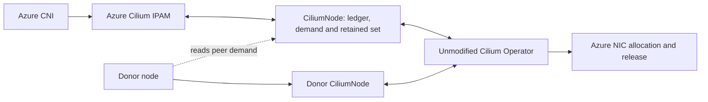
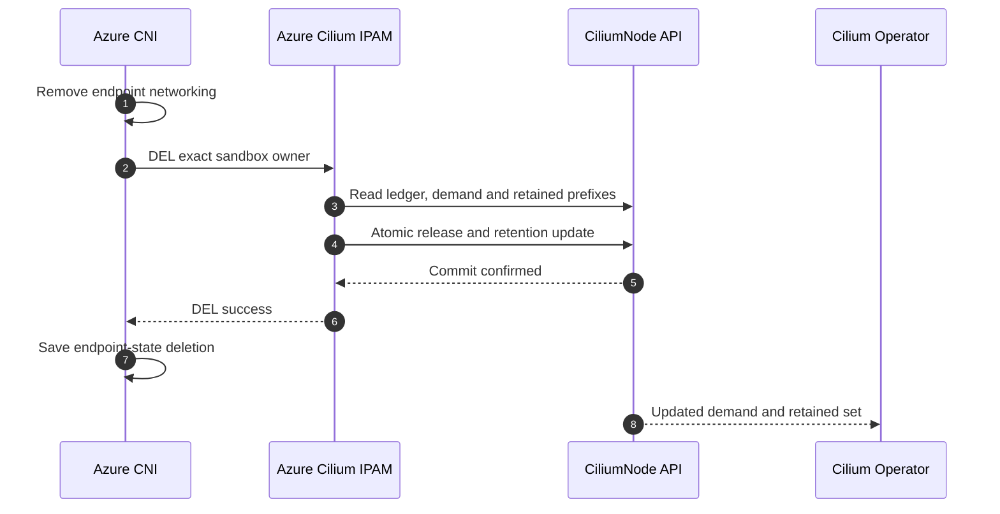
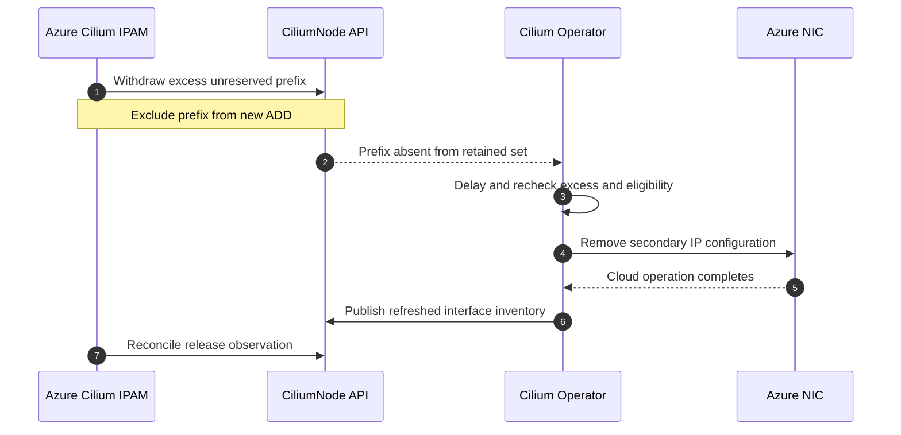
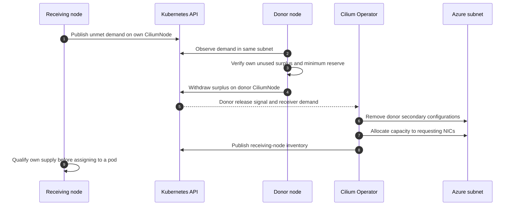
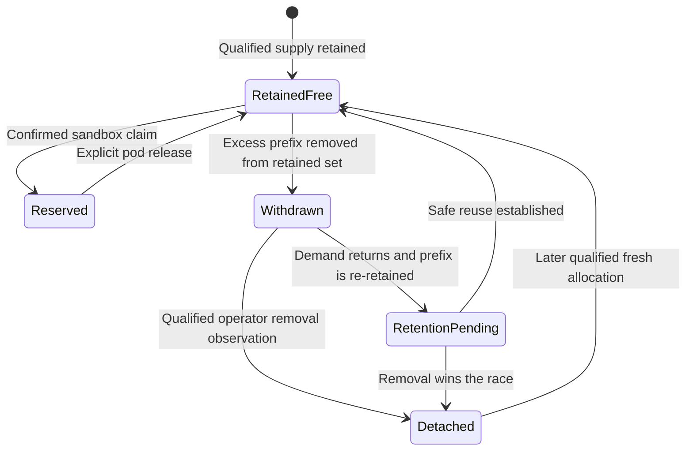
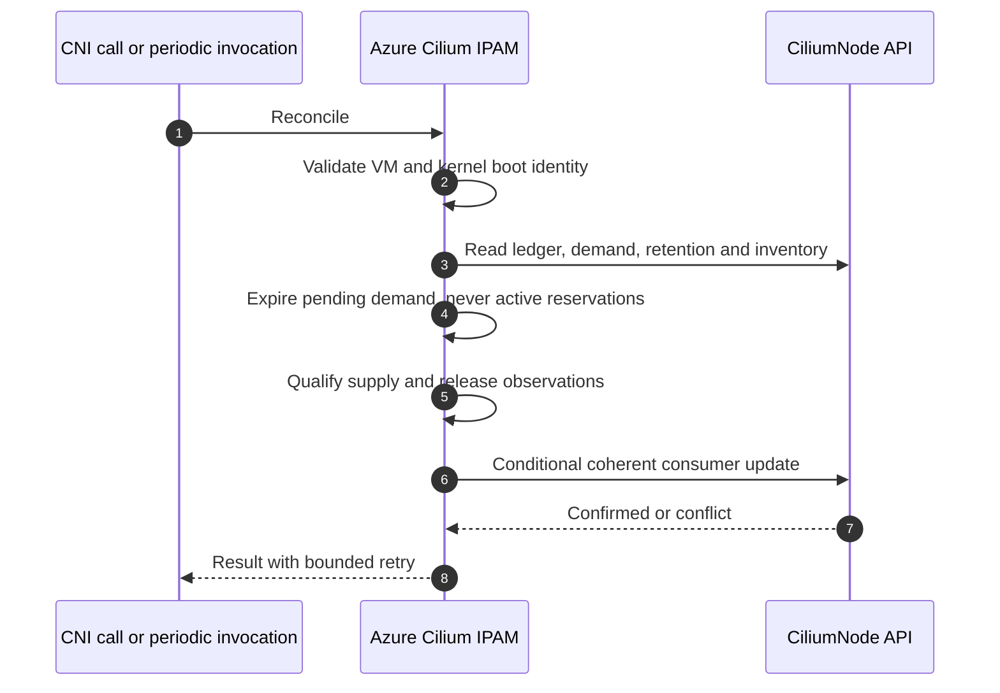

# Addendum: Azure subnet capacity reclamation and rebalancing

## 1. Release-capable allocation profile

Azure Cilium IPAM can return excess node capacity to an Azure subnet through
the **unmodified Cilium Operator multi-pool protocol**. Nodes may also observe
unmet demand on other nodes and voluntarily relinquish unused surplus in the
same subnet. The operator remains the only component that changes Azure NIC
IP configurations.

This is **release-and-reallocation of capacity**, not direct transfer of an
address. A secondary IP belongs to a NIC until Azure removes that configuration.
Updating two Kubernetes objects does not move it. Azure dynamically selects
the addresses assigned to a receiving NIC; the receiver cannot reserve a
specific donor IP or prevent another node from acquiring the freed capacity.

The release-capable profile has a distinct reservation contract:

| Responsibility | Release-capable profile |
| --- | --- |
| Per-sandbox reservation ownership | Versioned annotation on the node's CiliumNode |
| Desired address capacity | `spec.ipam.pools.requested` |
| Exact prefixes retained by the node | `spec.ipam.pools.allocated` |
| Operator-published Azure inventory | `status.azure.interfaces` |
| `status.ipam.used` | Empty; not the reservation store for this profile |
| Host endpoint information | Existing Azure CNI endpoint state |

Do not combine this contract with the legacy CRD allocation profile that
stores reservations in `status.ipam.used`. The operator recognizes the
multi-pool path from a default-pool request and an empty used map. A node
must run exactly one profile and one reservation authority.



**Figure 1. Nodes coordinate through Kubernetes; only the operator writes ARM.**

The scope is Linux standalone Azure VMs, individual secondary IPv4 addresses,
one selected NIC per node and a shared Azure subnet for each rebalancing group.
Primary addresses and addresses assigned to active sandboxes are not donation
candidates. Moving a running pod's address is outside this protocol.

## 2. Reservation bookkeeping on CiliumNode

Use the annotation
`azure-container-networking.io/ipam-state` for a serialized, versioned state
record. It is the authoritative per-node reservation ledger, not a local cache
or a copy of `status.ipam.used`.

The record contains:

| Entry | Purpose |
| --- | --- |
| Schema version, Node UID and immutable VM ID | Validate interpretation and node incarnation |
| Reservation owner and boot identity, indexed by IP | Duplicate ADD, exact-owner DEL and reboot reconciliation |
| Pending requests, indexed by stable sandbox owner | Include unfulfilled demand without counting retries repeatedly |
| Withdrawn-prefix records | Exclude relinquished addresses until the release/re-retention lifecycle is resolved |

Reservation owners include the network, sandbox ID and interface. A new
sandbox incarnation uses a new ID. Each reservation also identifies its kernel
boot and NIC resource. No successful reservation expires because of age.

Pending requests have no assigned IP. A retry refreshes the same request
instead of adding another. Successful allocation or explicit DEL removes the
pending entry. Unrefreshed pending entries expire after a bounded interval
of five minutes; expiration changes capacity demand only, never ownership
of an allocated address.

The implementation must bound entry count, identifier sizes and total encoded
size below Kubernetes' annotation limit, accounting for other annotations
already on the object. Reject a request before mutation if its record cannot
fit. Do not truncate reservations, discard withdrawn-prefix records to save
space, or silently treat invalid JSON as an empty ledger.

### One conditional transaction for consumer changes

Update the annotation, `requested` and `allocated` in a **single JSON Patch
against the main CiliumNode resource**, testing UID and resourceVersion.
These fields must not be written through unrelated, independently computed
updates. Preserve other annotations, spec fields and operator-owned status.

This makes the reservation and retained-set invariant enforceable across
concurrent plugin processes:

> Every reserved IP is retained. A withdrawn IP is neither reserved nor
> available to a new ADD.

The operator may update inventory concurrently. A version conflict causes
a fresh read and recomputation. An object replacement, invalid ledger or
nonempty `status.ipam.used` is an explicit contract error, not permission
to initialize a new empty consumer state.

## 3. Demand and the retained set

For the default IPv4 pool, define:

```text
U = number of confirmed reservations
P = number of unexpired pending requests
B = configured spare buffer
requested IPv4 addresses = U + P + B
```

Use the operator's configured preallocation value consistently. Do not lower
the request while leaving a different buffer configured: the operator derives
effective usage from the request and its preallocation setting.

`allocated` is the set of exact retained `/32`s. It includes **all reserved
addresses plus free capacity retained for pending work and the buffer**.
It is not a pod-IP list. Newly discovered addresses must be qualified against
the selected NIC, provisioning state, subnet and current guest observations.
The host primary and host-owned secondary addresses remain ineligible.

For two reservations, no pending requests and a one-address spare:

```yaml
spec:
  ipam:
    pools:
      requested:
        - pool: default
          needed:
            ipv4-addrs: 3
      allocated:
        - pool: default
          cidrs:
            - 10.0.0.10/32
            - 10.0.0.11/32
            - 10.0.0.12/32
status:
  ipam:
    used: {}
```

The annotation records which two addresses are reserved. The third is a free
spare. This is a field illustration, not a complete installable CiliumNode.

If `.13/32` was retained and becomes genuinely excess, remove it from
`allocated` and record it as withdrawn in the same conditional patch. Merely
reducing `requested` does not identify which address the node relinquishes.

Retention policy must respect the operator's allocation floor and batching
watermarks, including `min-allocate` and `max-above-watermark`. Conservatively
retain at least the greater of demand and the configured floor while enough
usable supply exists. An address the operator cannot consider excess should
not be withdrawn and stranded unnecessarily.

When available supply is below demand, retain the available eligible supply
and publish the unmet target. Never invent prefixes to make `allocated` match
the requested count. Report backpressure until usable supply arrives.

## 4. ADD, DEL and ordinary surplus release

ADD reads the ledger and inventory, resolves any required boot reconciliation
and looks for an exact-owner reservation. An eligible existing reservation
returns the same IP. Otherwise, allocate from qualified retained free capacity.
Commit the reservation, pending-request removal and resulting demand together
before returning success.

If supply is exhausted, persist or refresh the sandbox's pending demand and
return a bounded retryable allocation error. This gives the operator a target
even after the short-lived CNI invocation has exited.

Normal Azure CNI DEL removes endpoint networking, delegates IP release, then
saves endpoint-state deletion. The IPAM release removes the exact owner's
ledger entry and recomputes demand and retention atomically. A freed IP may
remain as a spare; DEL does not imply immediate cloud release.



**Figure 2. Pod release completes at the API boundary, not after Azure shrink.**

Failed-ADD rollback still attempts IPAM release independently of host-cleanup
errors. DEL without a saved endpoint can find and release the exact sandbox
owner in the annotation. API failures are reported, and remote ownership is
not treated as released until the change is confirmed.

The operator detects relinquished prefixes by comparing retained sets and
can recover candidates from attached inventory when rebuilding its tracking.
With `ipam.operator.releaseExcessIPs` enabled, it waits the configured
`ipam.operator.excessIPReleaseDelay` before evaluating cloud removal; the
default delay is 180 seconds.



**Figure 3. The operator releases the cloud address asynchronously.**

There is no CNI-to-ARM call, no explicit delete-IP RPC to the operator and no
guaranteed subnet-capacity recovery time equal to the configured delay. ARM
latency, eligibility, capacity floors, outages and competing demand affect
completion.

## 5. Optional cross-node pressure coordination

Ordinary surplus release is the default mechanism. Cross-node observation is
an optional policy layer for deciding when spare capacity can be reduced;
it is not needed to make the multi-pool release protocol function.

A receiving node publishes its pending demand on its own CiliumNode.
Potential donors may read CiliumNodes in the same rebalancing group and
compare demand with qualified capacity. Each donor alone decides whether
its own unreserved supply can be relinquished. Other nodes must not write
its ledger, release its reservations or infer unused capacity from
`allocated` alone.

Group nodes by the **full Azure subnet resource ID**, not by matching CIDR
text, Kubernetes namespace or node labels alone. Demand in another subnet
cannot be satisfied by freeing addresses here.



**Figure 4. Capacity flows through the subnet, not directly between nodes.**

Coordination is advisory and not an atomic two-node transaction. Another
requesting node may receive the capacity first, the donor may stop having
excess, or Azure may return different IP addresses. A donor acknowledgment
does not reserve a subnet slot for a particular receiver.

The donor must preserve its own reservations and pending demand. Pressure
cannot override allocation floors or primary-address protection. If a
configured policy permits reducing a donor's spare buffer, its new buffer,
request and retained set must remain consistent in the same consumer update
and respect a predetermined lower bound. Do not falsify usage to force shrink.
Without that policy, donate only supply already above the normal reserve.

Use bounded donation batches and hysteresis to avoid all nodes shrinking and
regrowing on each transient request. Nodes may rank eligible donors
deterministically, but stale peer observations still require local revalidation.
This layer provides neither strict fairness nor transfer of running workloads.
If all addresses are reserved or protected by minimum capacity, more subnet
capacity or workload placement changes are needed.

## 6. Withdrawal, renewed demand and the cloud-release race

A withdrawn prefix remains in the annotation's exclusion set while Azure
still advertises it. It is not available merely because it remains visible
in `status.azure.interfaces`. Reconciliation must preserve that exclusion
across plugin exits, process restarts and operator restarts.



**Figure 5. API ownership and cloud-release progress are different facts.**

Concurrent ADD and withdrawal are serialized through the same CiliumNode
conditional transaction. If ADD commits first, the address is reserved and
cannot be withdrawn. If withdrawal commits first, ADD must choose another
retained address or publish pending demand. Never delete reservations merely
to satisfy a peer's request.

The stock protocol allows a consumer to add a prefix back to `allocated`.
The operator cancels a release candidate when it observes that re-retention.
However, **a successful Kubernetes update does not acknowledge cancellation
of an Azure operation already in flight**. Nor does waiting less than 180
seconds prove that no release can occur.

Safe re-retention is a qualification boundary for the selected unmodified
operator build. The consumer must not assign a `RetentionPending` address
until the supported observation and ordering contract establishes that the
address remains available on the correct NIC and cannot be removed by the
prior release. No new operator acknowledgment field or capability marker is
assumed.

The following cases must be resolved by integration tests against the stock
release path: re-retention before the delay, at the end of the delay, after
the operator's final eligibility check and while the ARM request is running.
If that build cannot provide the required safe reuse behavior, release-enabled
operation is not qualified. The fallback is disabling shrink and using
growth-only allocation, not modifying the operator or assuming a timer is
an acknowledgment.

Simply quarantining withdrawn addresses forever is also insufficient: renewed
demand can make the operator stop considering them excess, leaving still-attached
capacity unusable. Qualification must prove both safety and eventual recovery
in this capacity-constrained case. Cross-node coordination must remain disabled
until this boundary is satisfied.

Similarly, stale inventory must not be treated as a fresh allocation after
release. Clearing a withdrawn record requires a qualified completed-removal
observation; reuse after that requires a qualified subsequent allocation.
An error, missing interface or failed inventory refresh is not proof of detach.

## 7. Reconciliation, bootstrap and reboot

Run bounded reconciliation from the same IPAM binary during ADD and DEL,
at node startup and periodically. A proposed default periodic cadence is
30 seconds. A systemd timer or equivalent platform invocation can run this
one-shot operation; it is not a persistent allocation daemon and stores no
local allocation journal.

Periodic work is required when no CNI requests occur: demand can expire,
operator inventory can change and release progress can complete while the
node is idle. Each invocation reconstructs its view from CiliumNode, guest
identity and current networking observations. Concurrent invocations use the
same conditional updates as CNI.



**Figure 6. Idle nodes still reconcile without a local allocation database.**

For a clean node, provisioning installs one allocation profile, establishes
Node/VM/NIC identity and creates a valid empty versioned ledger together with
the default-pool request. Do not enable multi-pool release against unexplained
existing allocations by publishing an empty retained set.

On restart within the same boot, restore reservations and withdrawn-prefix
records before recomputing retention. Do not interpret an absent or corrupt
annotation as zero usage. A missing ledger on an established node blocks
admission and shrink until ownership can be established.

On a real reboot of the same bound VM, retire recognized previous-boot
reservations and pending requests, then recompute demand and retention.
Preserve withdrawal history until its cloud lifecycle is resolved: rebooting
a VM does not cancel an operator ARM operation.

The host must use fresh sandbox identities and must not restore stale pod
namespaces, per-pod rules or endpoint files. Same-boot restarts and missing
host files do not authorize a usage reset. A different immutable VM ID,
Node UID, unknown schema or foreign owner is a contract error rather than
a global-cleanup trigger.

Switching from the legacy `status.ipam.used` profile requires a drained node
and resolved ownership. Do not clear that map while active endpoints exist
to force multi-pool detection. There is no live cross-profile migration in
this design.

## 8. Permissions and deployment requirements

Use an unmodified Azure-capable operator build that implements multi-pool
NIC-IP release. The image, chart and CRD must be qualified together.
Version labels alone are not proof that the required release path exists.
Enable excess release and record the actual release delay.

Azure Cilium IPAM needs named-object reads and main-resource patch permission
on its own CiliumNode, including its ledger annotation and supported pool
fields. This differs from a status-only writer. Enforce ownership and field
boundaries with the platform's authorization/admission controls; Kubernetes
RBAC alone does not provide per-field restrictions.

Optional peer observation requires additional read access. It does not grant
write access to other nodes. A cluster-wide read can expose annotations, so
limit access to trusted networking identities and avoid placing credentials
or unrelated private data in the ledger.

Only Cilium Operator receives cloud allocation/release responsibilities.
Nodes do not issue NIC delete/add calls and do not implement a second ARM
writer. Existing endpoint cleanup remains Azure CNI's responsibility.

Preserve guest-networking and policy behavior when a cloud address is returned
or later reused. Releasing a reservation or receiving an ARM response is not
proof that all policy changes have converged. Do not advertise safe identity
transfer or established-flow revocation from capacity rebalancing alone.

## 9. Required tests

| Scenario | Required result |
| --- | --- |
| Profile selection | Multi-pool request is present, `status.ipam.used` stays empty and the operator uses the intended path |
| Atomic consumer mutation | Annotation, demand and retained set commit coherently; stale updates cannot withdraw a newly reserved address |
| Duplicate requests | Retries preserve one reservation or one pending entry per sandbox identity |
| Pod release within buffer | Reservation disappears but the free spare stays retained |
| Excess pod release | Exact unused `/32` leaves retained set, cannot be assigned during withdrawal, and is removed from the NIC |
| Demand above supply | Persisted pending demand causes growth without inventing allocation or losing ownership |
| Release floors | Minimum allocation and batching floors prevent false donation promises or stranded unnecessary withdrawals |
| Concurrent ADD/withdrawal | Only one conditional transition wins and active ownership is never relinquished |
| Cancellation race | Test before delay, after eligibility selection and during ARM execution; no assigned address is detached |
| Rebound at NIC/subnet capacity | Withdrawn-but-attached addresses cannot cause permanent exhaustion; qualification establishes a safe recovery path |
| Operator restart | Release candidates survive the tracking rebuild without deleting retained or reserved addresses |
| Consumer restart | Ledger and withdrawal history are restored; retained sets are not reset to empty |
| Reboot | Old-boot reservations reconcile automatically while current-boot claims and unresolved release history remain protected |
| API outage/lost response | No offline allocation or assumed release; recovery re-reads authoritative state and is idempotent |
| Corrupt/oversized ledger | Fail explicitly before mutation; never truncate, silently default or overwrite usage |
| Cross-node demand | Only same-subnet spare capacity is considered; each node mutates only its own object |
| Competing receivers | Different assigned IPs or a different winning node do not violate a fictional direct-transfer promise |
| No donor surplus | Backpressure is explicit; running workloads and protected reserves are not evicted to fabricate capacity |

Confirm cloud release by observing that the donor NIC no longer has the
secondary IP configuration. Confirm successful reallocation on the receiving
NIC, then verify usable pod networking. A smaller annotation, a lower request
or a changed retained list alone is not evidence that subnet capacity returned.

## 10. Resulting guarantees and limits

The release-capable profile provides remote per-sandbox ownership, explicit
capacity demand and an exact retained-prefix set without a local allocation
database or operator code changes. Pod DEL and cloud shrink remain separate
events.

Cross-node pressure coordination can encourage unused surplus to return to
the common subnet. It cannot transfer an active pod's IP, guarantee a specific
address, reserve the released capacity for one receiver or promise completion
within the release delay.

The critical boundary is safe reuse when demand returns during cloud release.
That behavior must be established for the selected unmodified operator before
enabling shrink or cross-node coordination. API compare-and-swap protects
consumer state; it does not, by itself, serialize an external Azure operation.
