# Cilium Operator pools with Azure CNI

## 1. Document status and reading guide

**Design proposal, revised after the November 10, 2026 design discussion.**
This document replaces the earlier bridge/BoltDB specification. It describes
the intended architecture, not functionality already delivered by this PR.
The implementation at `5f3ea9af8423a835bc6ed934640ebf928646d8b9` still contains
the old bridge, databases and admission leases. Updating this specification
does not convert those binaries or qualify them for the revised contract.

The central change is a **separate, stateless `azure-cilium-ipam` CNI plugin**
that reads and updates CiliumNode directly. Azure CNI retains its existing
network/endpoint state. Cilium Operator remains the only component allocating
secondary IP configurations through Azure Resource Manager. There is no new
local allocation database, bridge database, allocation journal, persisted
admission lease or synchronization daemon.

Three categories of statements are deliberately distinguished:

| Category | Meaning |
| --- | --- |
| Meeting decision | Direction agreed in the supplied design discussion; summarized in section 2. |
| Proposed contract | A precise implementation choice needed to make that direction safe; subject to design sign-off. |
| Qualification requirement | Behavior that must be demonstrated before claiming a release capability; not an assertion that it works today. |

The work-item inventory was read on November 11, 2026. Its descriptions include
requirements written for the previous implementation. Sections 25-36 preserve
their functional intent while identifying obsolete mechanisms. This document
does not change work-item descriptions or states and does not imply that
an In Review task is completed.

For onboarding, read sections 2-8, then the successful ADD and DEL sequences.
For implementation, also read the conflict, failure, missing-state and identity
sections before writing code. For release review, use the work-item mapping,
qualification matrix and open-decision register. Diagrams are Mermaid source,
not images; they can be rendered by GitHub or a compatible Markdown renderer.
An arrow to the API means a Kubernetes API operation on CiliumNode, not an RPC
to the Cilium Operator process.

The document is intended as a long-form printable specification. Markdown has
no fixed page size: a page count is meaningful only after rendering the text,
tables and diagrams together. Use ordinary A4/Letter pages, readable body text
and complete diagrams rather than counting headings as pages. Source citations
and the artifact contract appear in section 40.

### Navigation

| Subject | Sections |
| --- | --- |
| Decisions, goals, boundaries and state | [2-6](#2-what-the-meeting-decided) |
| Configuration, registration and eligible supply | [7-9](#7-configuration-and-one-unambiguous-selector) |
| ADD, concurrency and failure semantics | [10-13](#10-successful-add-and-the-reservation-linearization-point) |
| DEL, retries and deferred async deletion | [14-17](#14-successful-del-and-safe-ordering) |
| Growth, release and node lifecycle | [18-21](#18-pool-growth-reserve-settings-and-backpressure) |
| Dataplane and policy | [22-24](#22-transparent-tunnel-forwarding-and-teardown) |
| Credentials, installation, health and availability | [25-30](#25-renewable-credentials-and-node-isolation) |
| Packaging, upgrades and operations | [31-33](#31-artifact-compatibility-mcr-and-release-packaging) |
| Qualification and work-item traceability | [34-37](#34-local-contract-and-regression-qualification) |
| Review answers, sign-off and sources | [38-40](#38-direct-answers-to-the-earlier-review-questions) |

## 2. What the meeting decided

The discussion explored alternatives before settling on a boundary. Early
suggestions to make all of Azure CNI stateless were **not** the final decision.
The later discussion established that delegated CNI DEL does not return the
address information needed to reconstruct Azure CNI's endpoint teardown. The
existing network state therefore stays; the additional IPAM state goes.

| Discussion position | Decision or qualification | Design consequence |
| --- | --- | --- |
| 9:29-11:35: communication through the node object | The operator and consumer coordinate through CiliumNode, not a direct operator API. | Kubernetes API reads and conditional status writes are on the IPAM path. |
| 16:09-20:35: retrieve allocation state from the CR | Remove the additional local allocation database. | CiliumNode is authoritative for pool and reservation state. |
| 20:35-25:41: asynchronous deletion | Async DEL was considered useful but explicitly deferred; synchronous retries are acceptable initially. | No new disk-backed deletion queue is introduced. |
| 26:17-38:32: fully stateless Azure CNI | Explored, then rejected for this iteration because endpoint teardown needs existing state and DEL returns no address result. | Preserve stateful `azure-vnet` and its existing endpoint store. |
| 39:05-43:26: reuse the existing pod-to-IP mapping | Azure CNI supplies the address it already knows when calling IPAM DEL. | Do not maintain a second local pod-to-IP mapping. |
| 43:26-46:21: component boundary and explanation | Use a separate Cilium-specific IPAM plugin; add architecture and sequence diagrams. | Proposed executable name: `azure-cilium-ipam`. |
| 46:35-50:23: distribution | Initially deliver binaries through an MCR image for self-managed extraction; integrate the new binary into release handling. | An installer DaemonSet is not a phase-one prerequisite. |
| 50:49-53:32: usage and dependencies | Usage belongs on CiliumNode; isolate Kubernetes-client dependencies in the new plugin. | Do not fold the client into the existing general IPAM binaries. |
| 53:32-55:27: reserve sizing and reclamation | Reserve settings are configurable; Azure reclamation needs source confirmation. | Growth is supported by the reference contract; automatic cloud shrink is not. |
| 56:30-58:02: end-to-end testing | Use reproducible standalone Azure VMs and gate releases on integration results. | Bicep-backed continuous qualification, not an AKS BYO-CNI substitute. |

The transcript occasionally uses "spec", "available" or "release" loosely.
This specification uses the actual schema: the operator owns
`spec.ipam.pool`, which contains **both used and unused addresses**; the
consumer owns its entries in `status.ipam.used`. Removing a used entry makes
an address locally unreserved. It does not remove a NIC IP configuration.

The meeting did not specify a concurrency algorithm, bootstrap ownership,
credential implementation, owner encoding, timeout values or a complete
lost-state recovery protocol. Those are made explicit below as proposed
contracts or release gates, rather than attributed to the participants.
The design also does not repeat the suggestion that an IP can be released
"blindly": a delayed DEL must never free another sandbox's reservation.

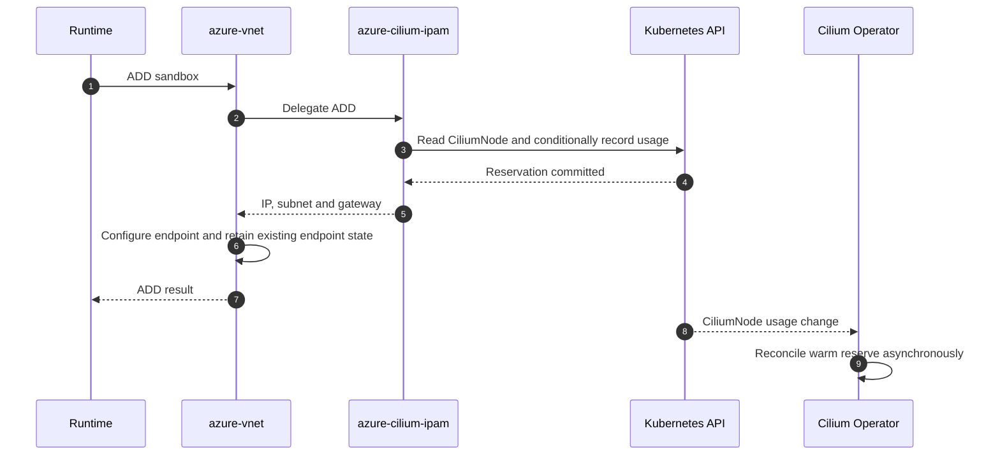

**Figure 1. Meeting-level component sequence.** The usage commit precedes the
IPAM success response. Operator replenishment is asynchronous and is not part
of the reservation transaction.

## 3. Problem, goals and scope

Self-managed Kubernetes on Azure needs dynamically sized pod-address pools
without relying on AKS-managed networking. Azure CNI must continue to provide
the Linux dataplane, including transparent-tunnel forwarding that sends
same-node pod traffic through the Azure enforcement path. Cilium Operator
already performs the cloud-side address management; replacing that allocator
would duplicate responsibilities and introduce competing NIC writers.

The design replaces only the node-side IPAM consumer role normally performed
by the Cilium agent. It does not replace the operator, add CNS, run the Cilium
agent in a reduced mode, or combine two primary CNIs. It uses individual
secondary IPv4 addresses, not pod CIDR/prefix delegation, even though the
user-facing goal is "pod-subnet-style" dynamic allocation.

| ID | Required outcome |
| --- | --- |
| R1 | Exactly one ARM pool allocator: Cilium Operator. |
| R2 | No local allocation persistence introduced by this integration. |
| R3 | Existing Azure CNI endpoint state and ordinary teardown remain available. |
| R4 | Every successful IPAM ADD has a confirmed, unique CiliumNode claim. |
| R5 | DEL cannot release a claim owned by a different sandbox. |
| R6 | No CiliumNode usage write destroys operator-owned or unrelated status. |
| R7 | Missing configuration, incompatible identity and API failures are explicit; no legacy allocator fallback. |
| R8 | Transparent-tunnel forwarding and source preservation remain intact. |
| R9 | Reproducible releases include the new binary and pass standalone-VM integration gates. |
| R10 | Operational limits and unresolved production gaps are stated, not inferred away from a successful smoke test. |

Initial scope is Linux, standalone Azure VMs, one selected primary NIC,
secondary IPv4 addresses and one node/pod subnet. Nodes are clean or fully
drained when changing consumers. VMSS, AKS, Windows, IPv6, delegated prefixes,
multiple allocation NICs and active-endpoint migration are separate extensions.
A cluster may still use kube-proxy and ordinary Kubernetes services; neither
Cilium kube-proxy replacement nor its eBPF dataplane is part of this design.

The phase-one delivery may be a self-managed evaluation release. It must not
be labeled production-ready merely because the core ADD/DEL path works.
Credential automation, host reboot behavior, policy-safe IP reuse, compatible
operator refresh and the Committed qualification tasks remain applicable
release gates for the capabilities they cover.

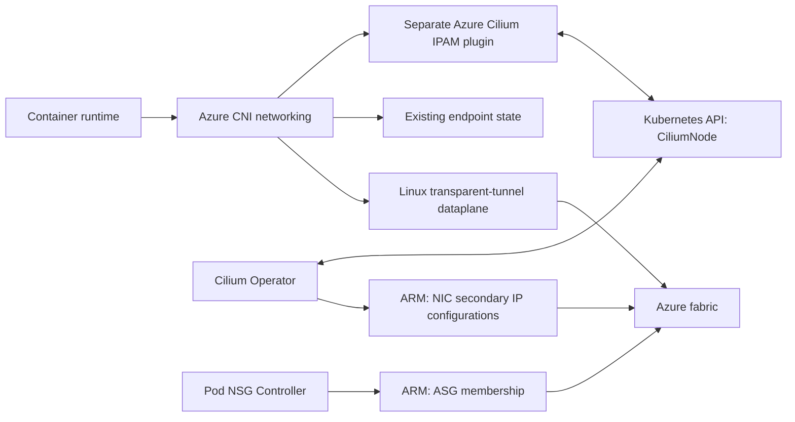

**Figure 2. System boundary.** There is no edge from the new IPAM plugin to
ARM, the old IPAM database or the Azure CNI endpoint store.

## 4. Components, processes and dependency boundaries

`azure-vnet` remains the runtime-invoked network plugin. It owns endpoint
creation, the existing endpoint-to-address record, Linux teardown and the
normal CNI result. It delegates address allocation and release to the
configured IPAM executable. Its new integration code should be limited to
selecting the appropriate invoker and passing the established request fields.
It must not learn how to parse CiliumNode or initialize a Kubernetes client.

`azure-cilium-ipam` is a short-lived CNI plugin process. An ADD or DEL starts
the process, which reads its configuration, authenticates to Kubernetes,
performs bounded work and exits. "Stateless" here means it has no persistent
local allocation database. It still uses in-memory request data, client
connections and a remote state transition. It is not a promise of zero state
in the entire system.

Cilium Operator runs independently, normally as a leader-elected deployment.
It observes CiliumNode, manages NIC secondaries through ARM and publishes
pool/interface information. Pod NSG Controller is an independent policy
component. It reconciles policy membership, not allocation ownership.

Registration is a provisioning responsibility in this proposal. A controlled,
replayable bootstrap step creates or validates CiliumNode before the node is
opened to workload scheduling. Ordinary ADD does not recreate a missing object.
This avoids reintroducing a long-running bridge solely to bootstrap identity
and avoids treating accidental CR deletion as an empty fresh pool.

The Kubernetes-client and Cilium wire-adapter code belongs behind the new
binary's package boundary. Reusing the repository's existing IMDS and NMAgent
clients is appropriate; modifying those clients to add special transport or
proxy behavior is not required. Shared request/response definitions must not
import the new allocator implementation back into generic CNI packages.

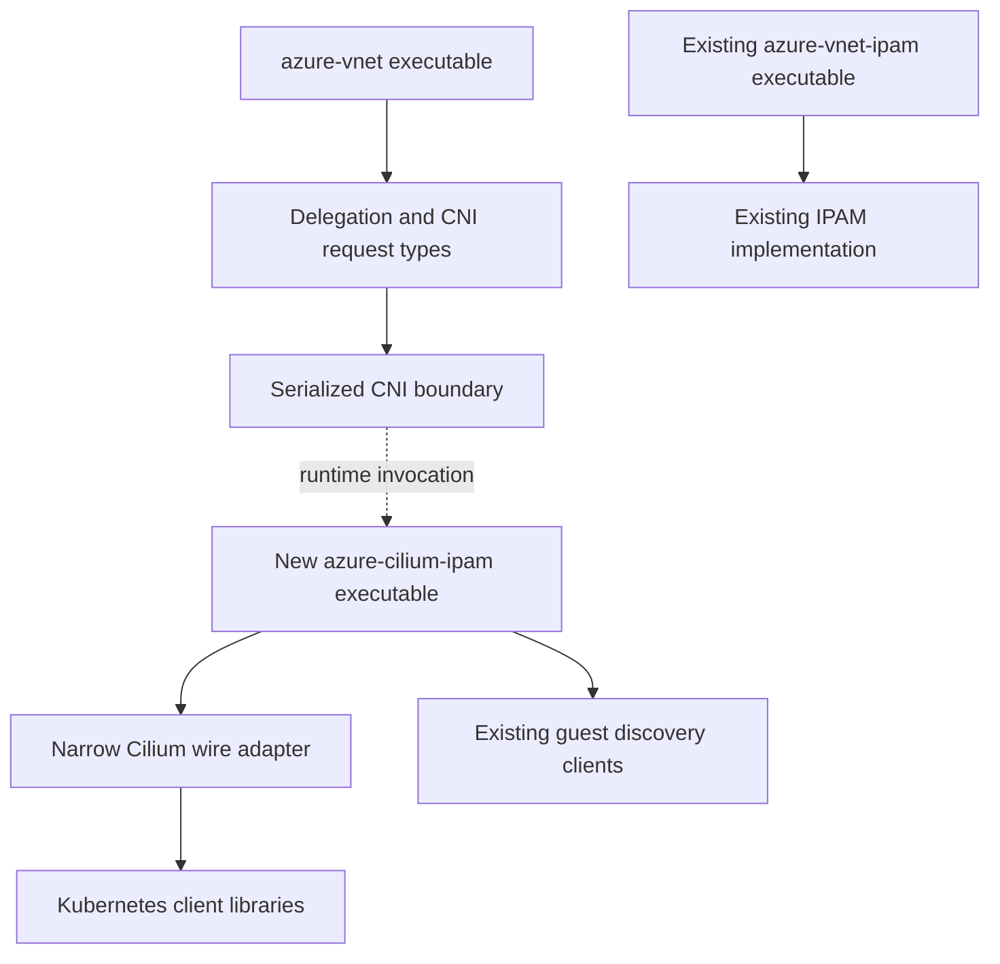

**Figure 3. Intended dependency direction.** The new plugin is selected across
a process boundary, not imported into the old IPAM executable. Existing
dependencies in other binaries are not retroactively claimed to disappear;
the acceptance criterion is that this feature does not add its client graph
to them.

The old `azure-vnet-ipam-bridge` service and its single-publisher lock are not
renamed into a new daemon. Packaging, examples and service units must eventually
reflect the new execution model. This documentation change does not perform
that implementation removal.

## 5. State ownership and what is removed

The meeting's request is to remove duplicate allocation state, not the
pre-existing state required by Azure CNI. The system has two intentionally
different records: CiliumNode says which IP is reserved; the existing network
record says which endpoint Azure CNI created and how to tear it down. They
are not interchangeable databases and there is no new synchronizer between
them.

| Data | Authority | Persistence and writer |
| --- | --- | --- |
| NIC secondary configuration | Azure network resource | ARM, written by Cilium Operator |
| Published node inventory | `spec.ipam.pool` | Kubernetes API, written by operator |
| Reservation and owner | `status.ipam.used` | Kubernetes API, changed by the IPAM plugin |
| Interface/resource metadata | `status.azure.interfaces` | Kubernetes API, written by operator |
| Container/endpoint addressing and teardown data | Existing Azure CNI network state | Existing network plugin and existing storage behavior |
| Current guest observations | IMDS, NMAgent and live host networking | Request-local observations; no new cache file |
| Policy membership | Policy resources and reconciled Azure ASGs | Pod NSG Controller |
| Installation configuration and credentials | Deployment platform | Root-protected inputs, not an allocation journal |

Remove the added BoltDB backend, added `.db` paths, bridge lifetime database,
persisted pool identity, bridge admission leases, boot-ID records and persisted
fence reasons. Do not retain the same mechanisms under renamed files. Do not
introduce a local "free IP" cache that can allocate while the API is unavailable.
Do not add a remote allocation record in a new CRD when the existing used map
already carries the required reservation.

Existing Azure CNI JSON state, its existing locking and ordinary logs remain.
This work does not change all pre-existing components into diskless programs.
Configuration and credentials are provisioning inputs; they do not carry
mutable per-allocation state. The new plugin should use the existing logging
pipeline or stderr rather than introducing a private recovery log.

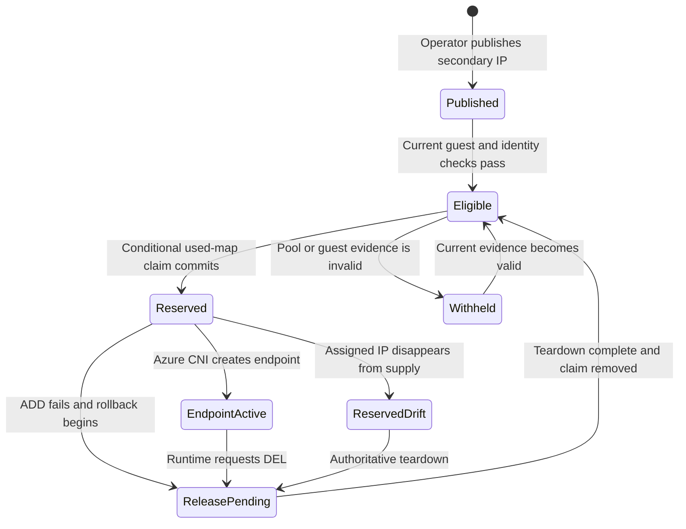

**Figure 4. Logical address lifecycle.** These are conceptual states, not new
persisted enum fields. A reserved address remains reserved during an API outage
or supply drift. No timer changes Reserved into Eligible.

## 6. CiliumNode wire contract

The reference contract is the Azure-capable Cilium v1.20.1 distribution and
the pinned source/artifacts in section 31. Consume its actual CRD shape rather
than a generic "Cilium version" assumption. A narrow local wire type or
unstructured client is sufficient; importing the Cilium agent's dependency
graph is unnecessary.

Important fields are:

| Field | Semantics and owner |
| --- | --- |
| `metadata.name` | Kubernetes node name selected by trusted provisioning. |
| `metadata.uid` | CiliumNode incarnation; included in conditional mutations. |
| `metadata.resourceVersion` | Opaque concurrency token; never parsed or incremented by the plugin. |
| `metadata.ownerReferences` | Binding to the expected Kubernetes Node UID. |
| `spec.instance-id` | Normalized standalone VM ARM resource ID, without the `azure://` prefix. |
| `spec.addresses` | Required node addresses, not pod assignments. |
| `spec.azure.interface-name` | Azure NIC name, not the Linux interface name `eth0`. |
| `spec.ipam.min-allocate` / `pre-allocate` | Operator-managed reserve policy inputs. |
| `spec.ipam.pool` | Operator inventory, including addresses currently used. |
| `status.azure.interfaces` | Interface identity, primary IP, subnet, gateway and address observations. |
| `status.ipam.used` | Claimed addresses with an owner and associated resource. |
| `status.ipam.operator-status` | Operator diagnostic state; the consumer preserves it. |
| `status.ipam.release-ips` | Release handshake field; not a pod DEL queue or policy-quarantine mechanism. |

For example, the following is an illustrative fragment, not a complete
installable object. The shortened resource value represents the selected
NIC's full ARM resource ID:

```json
{
  "spec": {
    "ipam": {
      "min-allocate": 10,
      "pre-allocate": 8,
      "pool": {
        "10.20.16.10": { "resource": "<selected-nic-arm-id>" },
        "10.20.16.11": { "resource": "<selected-nic-arm-id>" }
      }
    }
  },
  "status": {
    "ipam": {
      "used": {
        "10.20.16.10": {
          "owner": "<stable-sandbox-owner>",
          "resource": "<selected-nic-arm-id>"
        }
      }
    }
  }
}
```

The unused candidate is `.11`, not both entries in the pool. Used addresses
remain in `spec.ipam.pool`. A consumer must not delete them from that map or
publish all NIC secondaries into `used`. The `owner` field supports an identifier
representing usage; using it for replay protection is compatible with the
wire schema, but the encoding below is an Azure CNI proposal.

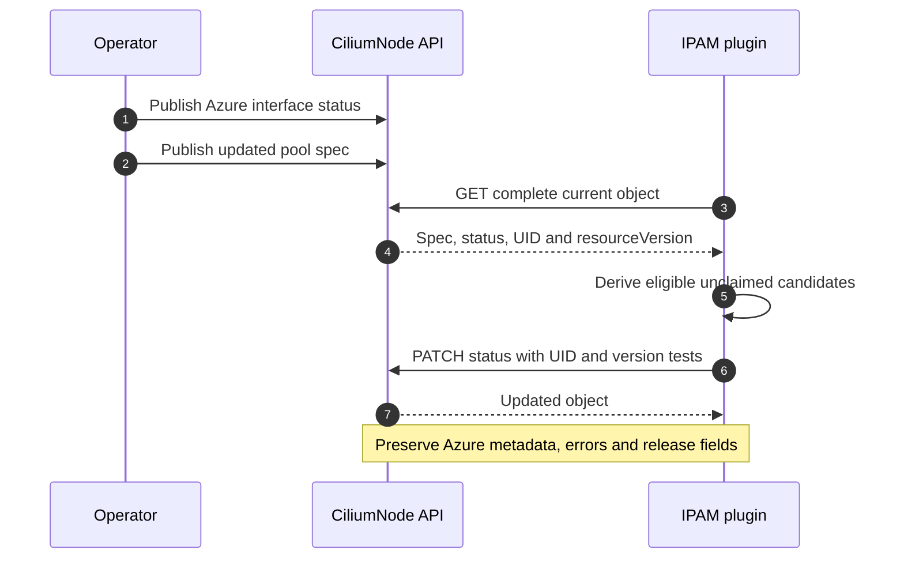

**Figure 5. Field ownership.** A coherent GET does not mean every external
system has converged. The consumer still qualifies each candidate against
current guest evidence.

## 7. Configuration and one unambiguous selector

**Proposed configuration contract:** select the new executable through
`ipam.type: azure-cilium-ipam`. Because the meeting chose a separate plugin,
this is simpler than retaining `azure-vnet-ipam` plus a second
`ipam.environment=cilium-pool` selector. File existence must never select
the allocator. The earlier `cilium-pool.json` mode-detection mechanism and
network-plugin inspection of that file are retired.

The outer plugin remains `type: azure-vnet`, `mode: transparent-tunnel`.
The existing network plugin passes the IPAM configuration to the delegated
binary. The new binary owns parsing its Kubernetes and discovery settings.
No `stateDir` option is introduced. A missing executable, unreadable credential
input, malformed setting or unsupported combination returns an actionable
error; none causes fallback to static Azure IPAM, CNS or a different CNI.

This illustrative fragment specifies the target shape, **not an already
implemented installation file**. Exact new field names require API review:

```json
{
  "type": "azure-vnet",
  "mode": "transparent-tunnel",
  "ipam": {
    "type": "azure-cilium-ipam",
    "nodeName": "<kubernetes-node-name>",
    "kubeconfig": "/etc/azure-vnet/cilium-ipam.kubeconfig",
    "interfaceName": "<linux-primary-interface>"
  }
}
```

The plugin validates node identity against live Node, CiliumNode and guest
observations; a configured name alone is not authorization. Resource identity
and reserve settings belong in controlled CiliumNode provisioning, not two
independently editable runtime configuration files. An endpoint DEL receives
the restored IP through the existing `ipam.address` delegation field.

The platform is responsible for installing a valid supported combination.
Validation should enforce the small real contract at the boundary, not scatter
scenario-specific filesystem tests through Azure CNI. Legacy configurations
that never select this plugin retain their existing behavior. An explicit
request for the new plugin must fail if its prerequisites are missing.

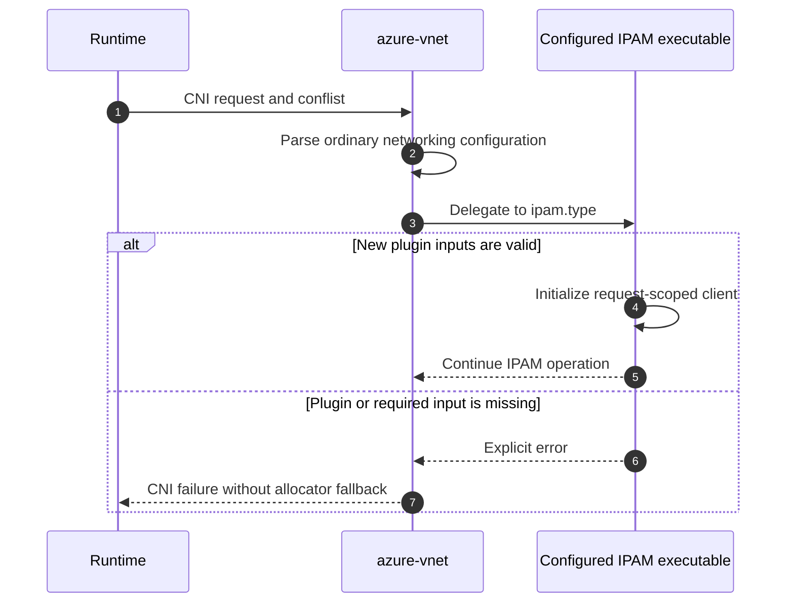

**Figure 6. Selection is explicit.** A missing executable is reported by the
delegation layer; it cannot execute the plugin's own validation.

## 8. Registration and bootstrap without a bridge daemon

The absence of the Cilium agent leaves a registration responsibility. It does
not require a permanent allocation-state synchronizer. The proposed phase-one
solution is an explicit provisioning operation that discovers the node's
identity, creates or validates CiliumNode and waits for qualified supply.
It is a prerequisite of making the node schedulable, not an implicit side
effect of every ADD.

Provisioning obtains the Kubernetes Node name/UID and live Azure VM identity.
It selects the primary guest NIC, resolves the corresponding Azure NIC and
subnet, and establishes the expected primary address. It sets the Node owner
reference, instance ID, Azure interface name, required addresses and reserve
settings. It does **not** seed an artificial empty used map over an existing
object or restore usage from a pod list.

When CiliumNode already exists, provisioning reads and validates it. A matching
object is left intact. A mismatch stops the operation and identifies the
conflicting Node/VM/NIC identity. Create races are handled by reading the
winning object after AlreadyExists, not by overwriting it. The privilege to
create objects is restricted to this bootstrap identity in the proposed model;
ordinary plugin credentials need no create or delete privilege.

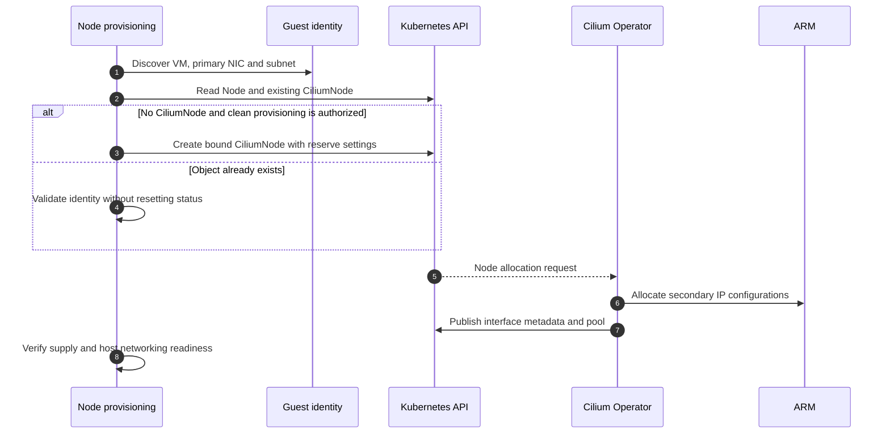

**Figure 7. Clean bootstrap.** Clean provisioning authorization is an
installation precondition, not something inferred from an empty directory.

If CNI runs too early, it returns a specific missing-object or empty-supply
error. It does not create local allocation state and cannot poison later
registration. After provisioning and operator publication complete, a fresh
runtime retry can succeed. An API outage is not NotFound. A missing CR on an
already active node is a lifecycle incident, not permission to reinitialize.

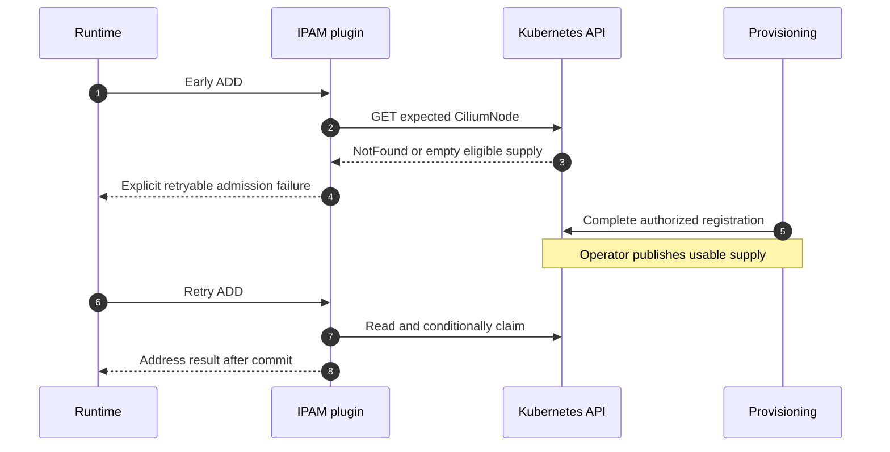

**Figure 8. Startup-order recovery.** No database deletion or fence-clear
operation is necessary to recover from an ordinary early invocation.

## 9. Qualifying supply before allocation

Presence in a CR is necessary but insufficient evidence that an address is
usable on this VM. The plugin derives eligibility from a current CiliumNode
and current guest observations. These observations are request-local, not a
new persisted admission lease. A candidate must satisfy all applicable checks
before the conditional claim is attempted.

| Check | Required interpretation |
| --- | --- |
| Node binding | CiliumNode belongs to the expected current Kubernetes Node and live VM identity. |
| Resource binding | The pool entry references the selected Azure NIC; normalize ARM ID comparison appropriately. |
| Address family | Individual IPv4 address in the selected subnet; no prefix or IPv6 allocation. |
| Primary exclusion | Neither the host primary address nor another host-owned address is offered to a pod. |
| Operator evidence | Compatible interface metadata contains the candidate in a successful address state. |
| Guest evidence | Fresh NMAgent discovery observes the secondary on the selected interface. |
| Reservation | The address is absent from `status.ipam.used`, unless this is an exact-owner replay. |
| Release state | No active unsupported cloud-release handshake applies. |
| Host usability | The host must not have installed the pod secondary as its own local address. |

Use the existing IMDS/NMAgent clients and distinguish their roles. IMDS
establishes VM/interface identity; NMAgent observes programmed guest supply.
Neither tells the operator which pod owns an address. The used map supplies
that reservation information. The transparent-tunnel next hop is still taken
from the live primary-interface IPv4 default route, not a stale persisted
gateway.

A newly published address may temporarily fail guest visibility. Withhold it
and return supply-not-ready when no other valid candidate exists. Do not repair
the delay by independently adding NIC addresses. A malformed or foreign
identity is a configuration/contract error, not merely an empty pool. Missing
optional interface-level provisioning state must not be confused with a
non-successful per-address state when the pinned schema permits that omission.

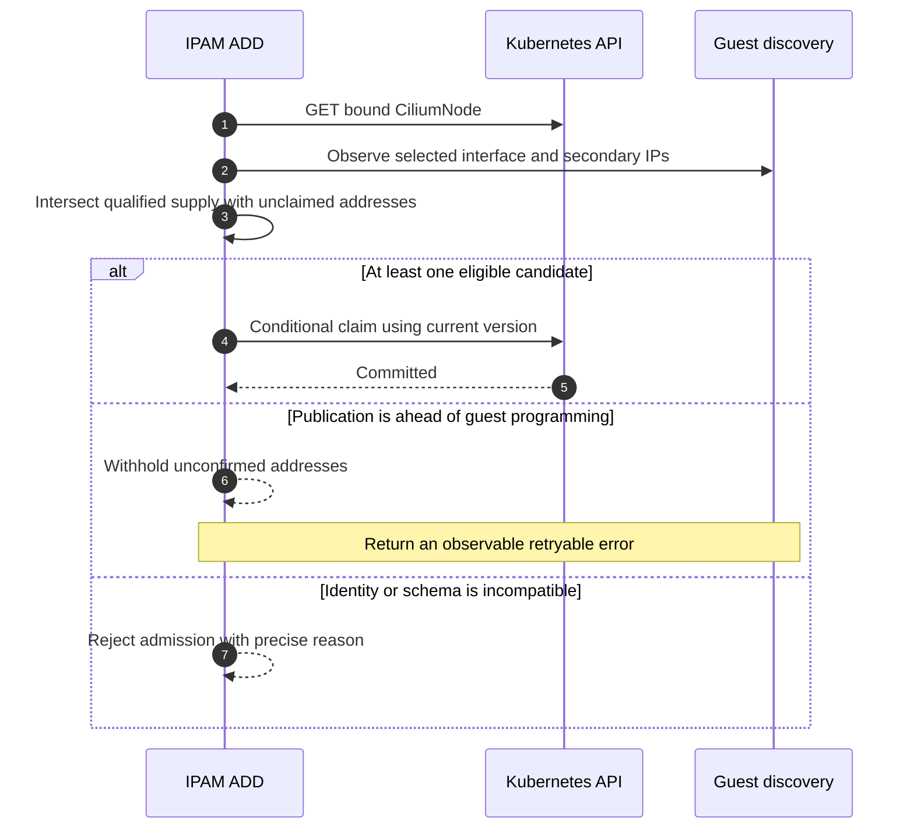

**Figure 9. Supply qualification.** The status mutation also protects against
an intervening operator withdrawal. No atomic transaction spans ARM, the API
and guest programming; external NIC changes remain a monitored lifecycle risk.

## 10. Successful ADD and the reservation linearization point

The IPAM plugin's success point is the confirmed Kubernetes API mutation,
not selection of an address in memory and not a later background publication.
Until that commit succeeds, the candidate must not be returned for endpoint
creation. The API server serializes competing conditional changes.

The request carries the network name, sandbox/container ID and interface name.
The plugin derives a stable owner identifier and first looks for an existing
claim for that exact owner. Otherwise it chooses one eligible free address,
copies its NIC resource identifier into the used entry and conditionally
patches the status subresource. The proposed owner format is versioned and
collision-free, for example
`azure-cilium-ipam/v1/<escaped-network>/<escaped-sandbox>/<escaped-interface>`.
The actual encoding must be fixed by contract tests; ambiguous concatenation
or a pod name alone is not sufficient.

The ADD result uses the ordinary delegated CNI IP result: the selected IPv4
address with the correct prefix, gateway and required routes. It is not a
custom operator response. Azure CNI then creates the endpoint and stores the
network information it already needs. Kubernetes pod status may be updated
later by the runtime; it is not the allocation commit record.

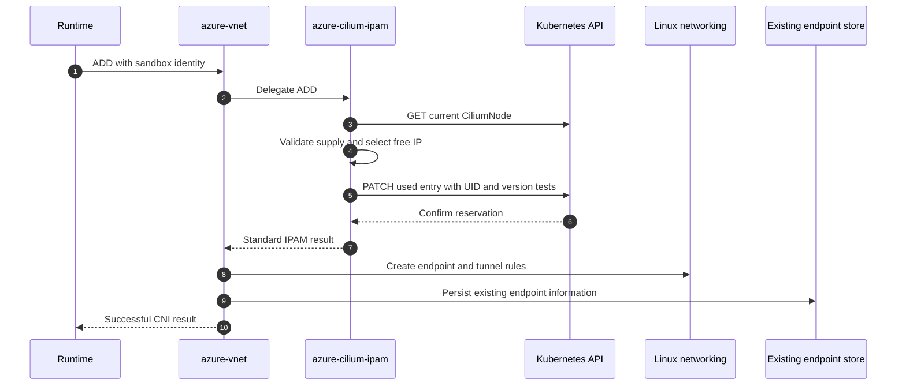

**Figure 10. Successful ADD.** The local store write is the pre-existing network
record, not a new IPAM record.

The endpoint write and remote claim are not a distributed transaction. Failure
after reservation requires compensation, and a crash can leave a claim without
a usable endpoint. The safe direction is temporary over-accounting, never
making an address free while a live endpoint might still use it. Sections
13-16 define that boundary. The implementation must not claim exactly-once
execution; it provides replay-safe operations with a single remote reservation
commit point.

## 11. Duplicate ADD, replay and owner identity

A repeated ADD for the same sandbox/network/interface must not consume a
second IP. The plugin searches the current used map for its stable owner.
Exactly one compatible claim is returned after revalidating eligibility.
Two claims for the same owner are an invariant violation requiring diagnosis,
not permission to choose whichever map entry happens to be first.

The owner is a sandbox identity, not merely a workload label, pod name or
namespace. A replacement pod with the same name can have a different sandbox.
It must not inherit the previous sandbox's claim. Conversely, an uncertain
response must not cause the same sandbox to acquire a second claim on retry.
Unknown owner formats are treated as occupied addresses and preserved; they
are not silently adopted or garbage-collected.

If the exact-owner IP was withdrawn or is no longer guest-visible, ADD returns
an error rather than allocating another IP for that owner. The claim remains
available to DEL. Restoring current eligibility can allow a later replay to
recover, but no persisted fence needs to be manually cleared. A changed
CiliumNode incarnation is not ordinary eligibility recovery.

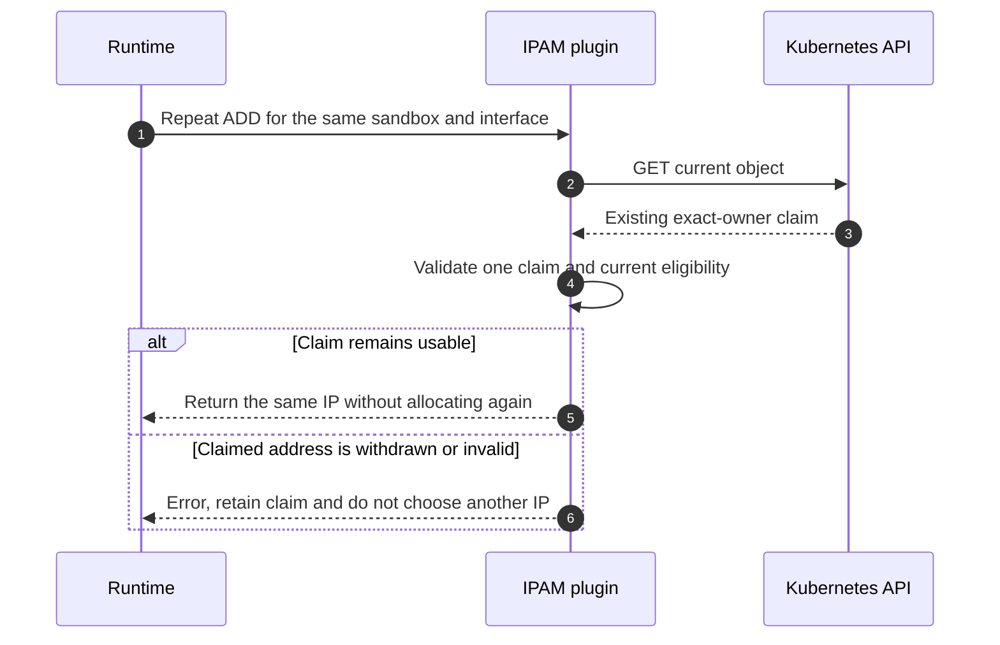

**Figure 11. ADD replay.** Returning the same result is contingent on current
eligibility, not merely finding an owner string.

The caller must also preserve the network plugin's existing ADD idempotency
and avoid replaying destructive endpoint setup. The owner format does not
replace existing endpoint IDs or require a new pod-to-IP disk index. Tests
must exercise duplicate requests from separate processes, including a retry
after the first process has exited.

## 12. Concurrent reservations and shared-status preservation

Removing a local IPAM lock does not remove the need for serialization at the
allocation authority. Two plugin processes can read the same free IP. They
must not both succeed. The proposed algorithm uses a JSON Patch on the status
subresource with tests for the observed CiliumNode UID and resourceVersion.
The successful write is the winner; a stale writer re-reads and recomputes.

The patch changes only the consumer-owned used map or its selected entry.
When replacing a complete used map, derive it from a fresh object and preserve
all other entries, including unknown owners. Preserve all unrelated fields
and avoid decoding/re-encoding an entire status object through a partial type.
If `status.ipam` or `used` is absent, construct only the missing parent
structure under the same conditional tests. Never replace a populated parent
with an empty object to make a patch path valid.

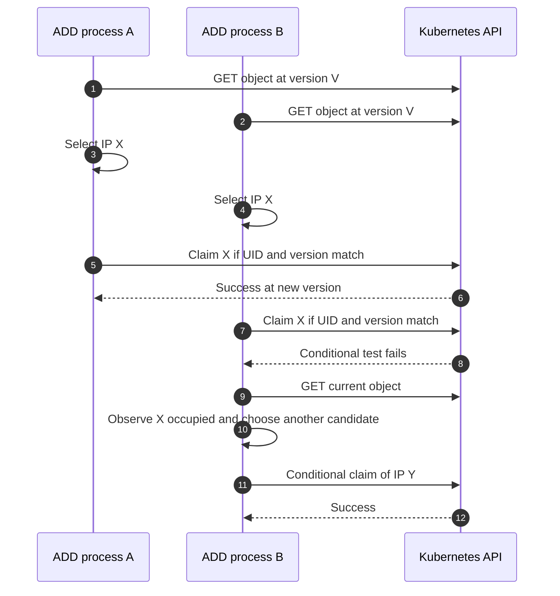

**Figure 12. Cross-process concurrency.** Selection alone grants no ownership.

Retries are bounded by the request context, API timeout and a finite conflict
budget. Use bounded jitter/backoff rather than spinning. Exact defaults are
release configuration decisions to be established by the latency tests; the
contract does not allow an unbounded loop inside one CNI invocation.

An API conflict is retryable. A JSON Patch test failure may be reported as
Invalid rather than Conflict. Do not retry every Invalid response: re-read
and confirm that the resourceVersion changed before classifying it as a
concurrency race. A changed UID is a replacement error, and an unchanged
object with an invalid patch indicates a request/schema defect.

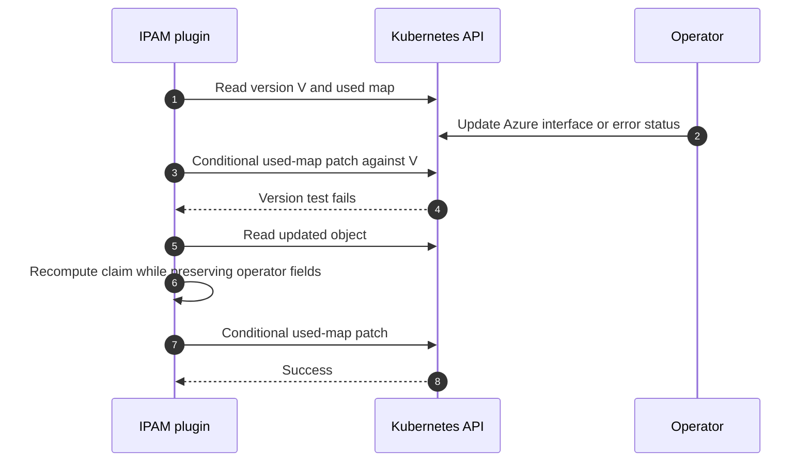

**Figure 13. Operator/consumer concurrency.** Tests must also verify that the
qualified operator preserves usage when retrying its own stale status writes.
Consumer correctness alone cannot compensate for a second writer that
unconditionally overwrites the used map.

## 13. ADD failure, uncertain commits and compensation

Failures fall into three materially different groups. Before the claim commits,
no address is granted. After a confirmed claim but before endpoint success,
Azure CNI owns rollback. After a response is lost, the caller cannot infer
whether the claim committed. All three must be represented in tests and logs.

| Failure window | Required outcome |
| --- | --- |
| GET, authentication or guest discovery fails | Return an error without allocating locally. |
| Claim is rejected by a concurrency test | Re-read and retry within the budget. |
| Claim response is lost | Do not select another IP blindly; recover through the stable owner. |
| Endpoint setup fails after confirmed claim | Remove partial networking, then release the exact claim. |
| Local endpoint persistence fails | Treat ADD as failed; clean up or retain the claim until teardown can be established. |
| Process dies after claim | Runtime replay/DEL or a fenced recovery procedure resolves ownership; no time-based free. |
| Rollback cannot reach the API | Retain the claim and surface the incomplete rollback. |

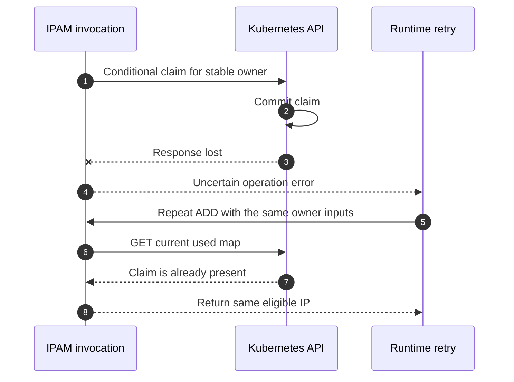

**Figure 14. Lost response.** No local write-ahead log is needed because the
stable owner can be recovered from the authoritative object.

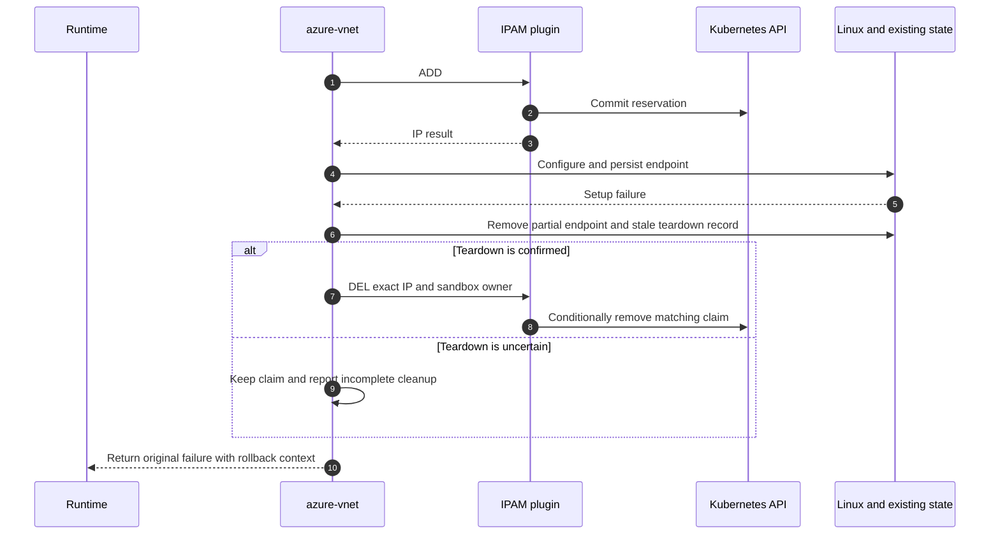

**Figure 15. Failed ADD compensation.** Cleanup errors must not be hidden by
the original endpoint error or converted into a successful ADD.

No background scan frees claims based solely on a pod being absent from the
API. Pod status can lag, kubelet can be partitioned, and a container can still
have a live endpoint. A leak is an operational problem; duplicate use is a
correctness failure. The design prefers retaining a questionable claim until
teardown is authoritative.

## 14. Successful DEL and safe ordering

The meeting's normal DEL path is straightforward: Azure CNI restores its
existing endpoint information and passes the known IP to the new plugin.
The existing invoker already uses `ipam.address` for an explicit address.
The delegated DEL returns success or an error; it does not return the IP
to the network plugin. This is why the endpoint store is retained.

**Proposed ordering refinement for sign-off:** remove endpoint networking,
successfully retire the teardown-bearing local endpoint record, and only then
make the remote IP claim reusable. Keep the restored endpoint information in
memory long enough to delegate the release. This differs from the current
source's release-before-`DeleteState` ordering and is required to avoid a
stale local record causing a later DEL to remove rules for a reused IP.

The refinement introduces no new persistent state. It does mean that a failed
remote release can leave a claim after the endpoint record is gone. Section
15 specifies recovery by stable owner and verified teardown. This change and
its missing-endpoint behavior must be reviewed together; changing one without
the other would create a leak or unsafe retry path.

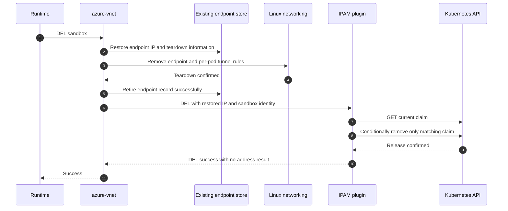

**Figure 16. Target DEL ordering.** This is a proposed safety requirement, not
a claim about the existing implementation or an ordering explicitly settled
in the transcript.

The new plugin validates owner and resource identity before release. It need
not require current guest metadata or that the IP still appears in the pool:
those conditions can disappear while a valid old claim still needs deletion.
It must require trustworthy access to the intended CiliumNode and preserve
every other reservation. DEL does not reduce `spec.ipam.pool`, call ARM or
wait for the operator to notice the usage reduction.

## 15. Duplicate DEL, absent endpoint state and stale requests

DEL must be repeatable after success and after partial failure. An explicit
address with no matching claim is already released. A matching claim is removed
conditionally. A different owner at that address is never removed. If a stale
request encounters another owner, the implementation must report that outcome
without mutating the new claim; whether the caller classifies a proven old
completed DEL as success or an ownership diagnostic is part of the final error
mapping, not permission to free the new owner.

Normal DEL uses the restored IP, as agreed in the meeting. Owner-based lookup
is a **proposed exceptional recovery path**, not a second local pod mapping.
It is needed when ADD committed but its response was lost, or when local
teardown completed before a remote release failed. A bare missing state file
does not prove either case.

The network caller must establish that the specific old sandbox endpoint has
been removed using the runtime's lifecycle and the existing deterministic
endpoint/network cleanup mechanisms. It must not delete an IP-scoped rule
for an address now belonging to another endpoint. If sandbox teardown cannot
be established, stop and retain the claim. The exact no-record teardown checks
are an implementation sign-off gate, particularly when the namespace is gone.

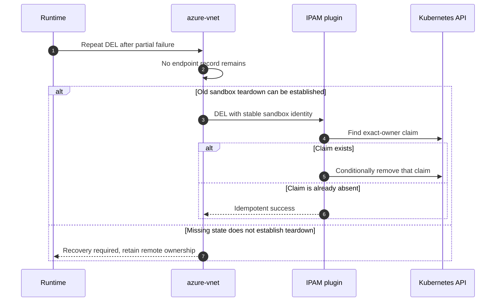

**Figure 17. Missing endpoint record.** Never infer safety solely from a
directory being empty or a pod disappearing from Kubernetes.

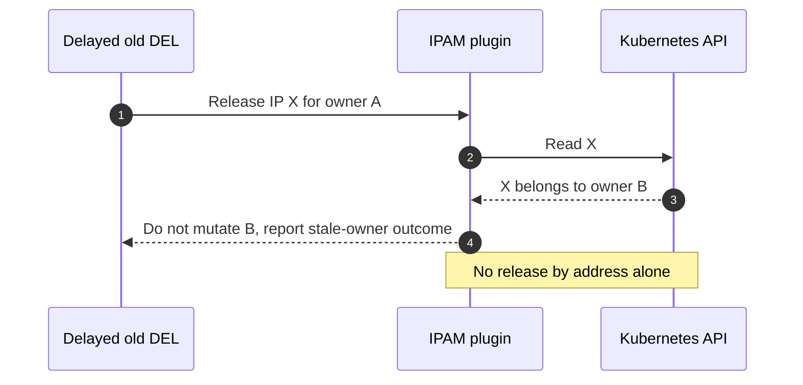

**Figure 18. Stale deletion after reuse.** The owner comparison is mandatory
even though the caller supplied an IP from its old state.

## 16. API failure during DEL and bounded retries

The old bridge design allowed local release while remote publication lagged.
That is no longer the contract. With CiliumNode authoritative for reservations,
the new plugin cannot confirm release while the Kubernetes API is unreachable
or authentication fails. It returns an error and retains the remote claim.
Existing traffic unrelated to that DEL does not depend on continued API reads.

The network plugin may already have removed the endpoint before release fails.
Therefore "DEL failed" does not necessarily mean that the pod's dataplane still
exists. Report the stage clearly. The runtime can retry and the stable-owner
path can complete release after connectivity returns. A pod may remain
Terminating while the runtime awaits successful teardown; this availability
tradeoff was explicitly accepted for phase one.

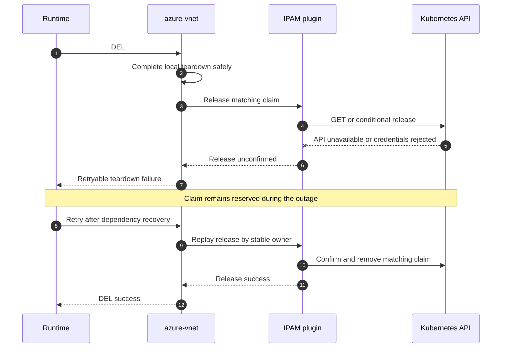

**Figure 19. Synchronous retry model.** A retryable outcome is not an infinite
retry loop inside the original process.

DEL must not depend on new allocations being possible. It should work with
an empty pool, a withdrawn address, an operator outage or unavailable NMAgent,
provided the object identity and ownership can be established and the API
accepts the release. Test this separation explicitly. Conversely, treating
Forbidden as a successful release would hide leaked reservations and is
not allowed.

The Committed credential and availability tasks previously required DEL to
continue during authentication/API failures. Preserve the goal of local
cleanup and safe ownership, but record that **completed remote release during
such an outage is incompatible with phase-one synchronous, API-authoritative
IPAM**. It needs a separately approved async mechanism or a revised acceptance
statement; this document does not silently claim both.

## 17. Asynchronous DEL is deferred, not secretly implemented

The meeting considered the existing CNS pattern in which CNI writes a deletion
request and a long-running component later consumes it. That can unblock pod
termination independently of IP reclamation. It also introduces a persistent
queue, a consumer and recovery rules. None is automatically supplied by a
short-lived stateless CNI executable.

Phase one therefore uses synchronous release with runtime retry. There is no
new directory of pending IP deletions, no background goroutine surviving the
CNI process, no renamed bridge that periodically releases addresses, and no
timer that expires used entries. The old CNS mechanism remains unchanged for
its existing consumers; its existence is not permission to wire this plugin
into it implicitly.

The following diagram describes a **future alternative**, not the delivered
contract. It is included to make the deferral concrete:

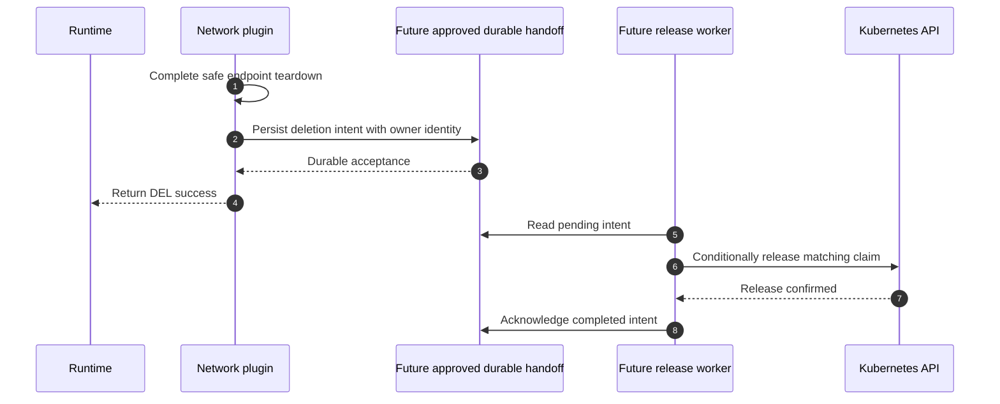

**Figure 20. Deferred async deletion.** Every participant labeled future would
need an approved owner, lifecycle, authentication and crash-recovery contract.

If async deletion becomes necessary, a separate design must explain where the
handoff is stored, how it survives reboot, who retries it, how duplicate intents
are handled, and how old intents cannot release a new owner. It must reconcile
that storage with the requirement not to add local allocation state. It must
also distinguish runtime pod-capacity recovery from IP-capacity recovery:
terminating a sandbox does not free its remote claim until the release is
actually committed.

## 18. Pool growth, reserve settings and backpressure

Cilium Operator observes the used map and decides when to grow the node's
cloud pool. The plugin does not implement a competing sizing loop. It does
not call the operator directly, allocate addresses through ARM, or publish
invented usage to force growth.

For orientation, ignoring capacity limits, batching and backend details, the
reserve deficit is approximately:

```text
max(0, used + preAllocate - allocated, minAllocate - allocated)
```

This is an explanatory model, not an algorithm to copy into Azure CNI.
The pinned operator applies its own limits and allocation actions. For a pool
of ten with preallocation eight, usage of two leaves eight unreserved IPs.
Usage of three creates a reserve deficit of one; actual growth can be batched.
The free count is not necessarily the plugin's eligible-free count because
guest programming or validation can withhold addresses.

```mermaid
sequenceDiagram
    autonumber
    participant I as IPAM plugin
    participant K as CiliumNode API
    participant O as Cilium Operator
    participant A as ARM
    participant G as Guest programming
    I->>K: Commit real pod reservation
    K-->>O: Usage changes
    O->>O: Compute reserve deficit and available capacity
    O->>A: Add secondary IP configurations
    A-->>O: Cloud operation completes
    A-->>G: Program addresses
    O->>K: Publish metadata and expanded pool
    I->>K: Later ADD reads expanded supply
    I->>G: Confirm guest visibility
    I->>K: Claim newly eligible address
```

**Figure 21. Usage-driven replenishment.** The claim acknowledgment does not
wait for replenishment when already-qualified supply exists.

When no eligible free address exists, return explicit backpressure. Distinguish
an empty pool, all addresses reserved, guest publication lag, identity failure,
operator errors and subnet/NIC capacity exhaustion. Do not retry by deleting
the old Azure IPAM state file. That legacy fallback has no place in this path.

The earlier demo showed growth with the reference operator, but also exposed
a standalone-VM incremental-refresh warning that periodic full resync masked.
Task 40396607 remains a separate compatibility requirement. A passing test that
eventually succeeds after full resync is not proof that incremental refresh
is healthy or that growth latency has a production bound.

## 19. Pod release is not cloud reclamation

The meeting left cloud reclamation for confirmation. The pinned Azure backend
provides a concrete answer: `PrepareIPRelease` returns an empty release action,
and `ReleaseIPs` returns an unimplemented error. The schema's release-handshake
fields do not establish that the Azure backend performs NIC address removal.
See the pinned [Azure backend source][src-azure-backend].

Consequently, a successful pod DEL removes the matching used entry and leaves
the operator pool/NIC configuration intact. The address can be reused locally
once it is eligible and any required policy transition is safe. The subnet
continues to account for the NIC address. Lowering a reserve setting does not
promise that already allocated secondaries are returned to the subnet.

```mermaid
sequenceDiagram
    autonumber
    participant C as Azure CNI
    participant I as IPAM plugin
    participant K as CiliumNode API
    participant O as Cilium Operator
    participant A as ARM NIC
    C->>C: Complete endpoint teardown
    C->>I: Release pod claim
    I->>K: Remove matching used entry
    K-->>O: Usage decreases
    O->>O: Reconcile retained warm pool
    Note over O,A: No supported automatic NIC-IP release in reference backend
    Note over K,A: IP remains allocated to the node, but locally unreserved
```

**Figure 22. Phase-one release.** There is intentionally no ARM delete arrow.

Growth-only operation needs an explicit capacity budget and safe decommission
procedure. It is not intrinsically a leak in the consumer: warm pool retention
is the supported backend behavior. Operators must distinguish retained cloud
supply from orphaned used entries and from stale ASG membership.

A future release-capable backend requires a separately qualified consumer
handshake. A candidate must become unavailable to ADD before it is acknowledged
as safe for cloud deletion, and that exclusion must survive concurrent
processes and API failures. No acknowledgment may be sent for an owned IP.
The state model must be remote and compatible with the no-new-local-state rule.

```mermaid
sequenceDiagram
    autonumber
    participant O as Future release-capable operator
    participant K as CiliumNode API
    participant I as Qualified consumer
    participant A as ARM
    O->>K: Mark unused candidate for release
    I->>K: Read candidate and current ownership
    alt Address has an owner
        I->>K: Refuse release using approved handshake
    else Address is durably excluded from all ADD paths
        I->>K: Acknowledge release under concurrency protection
        O->>A: Delete secondary configuration
        O->>K: Publish completed release and remove supply
    end
```

**Figure 23. Future-only cloud release.** Phase one never sends
`ready-for-release`; unexpected release activity rejects new admissions until
the incompatible condition is resolved. This is a current-condition check,
not a permanent local fence.

## 20. Object identity, replacement and destructive recovery

Live validation can detect a mismatched Node owner UID, foreign NIC, wrong
instance ID or CiliumNode UID change during a request. It cannot reconstruct
history that was deleted. Removing the old local identity database therefore
removes the old historical-fence guarantee as well. The specification must
not promise to detect every VM reincarnation using only a reusable ARM name.

Normal plugin credentials cannot create, delete or rebind CiliumNode.
Unexpected NotFound blocks ADD and prevents blind recreation. A UID change
between GET and PATCH rejects the operation. Neither action reconstructs
lost reservations, and neither proves that a previously running VM has stopped.
The platform must fence or drain an old node before replacing its Node,
CiliumNode, VM, NIC or subnet.

Here, **fencing** means establishing that the old VM/sandbox cannot continue
using the addresses, for example through a verified stop/decommission
procedure. Cordon alone is not fencing: existing pods can continue to send
traffic. Deleting a Kubernetes Node object is not proof of VM shutdown.
Deleting CiliumNode can also trigger loss of the only remote reservation map.

```mermaid
sequenceDiagram
    autonumber
    participant P as Platform operator
    participant V as Old VM and workloads
    participant K as Kubernetes API
    participant N as Replacement provisioning
    P->>V: Drain or establish authoritative fencing
    V-->>P: Old endpoint use has ended
    P->>K: Reconcile old ownership and object lifecycle
    P->>P: Confirm NIC and policy cleanup responsibilities
    P->>N: Authorize replacement
    N->>K: Create or validate new identity binding
    N->>N: Qualify supply before scheduling
```

**Figure 24. Controlled replacement.** This is an administrative lifecycle,
not an automated side effect of a missing file.

If CiliumNode is deleted accidentally while pods remain, isolate the node from
new allocation and preserve available evidence. Do not create a replacement
with empty usage and immediately admit pods. Recovery may require draining or
stopping the VM, validating endpoint teardown and reconciling cloud/policy state
before fresh registration. An approved recovery can use observed endpoint
records as evidence, but an automatic pod-list-to-used-map rebuild is not part
of this design.

Admission protection for object deletion/rebinding and the exact recovery
authority are release decisions. Without them, the product has a documented
destructive-administrator limitation, not the stronger guarantees of the
superseded persisted-identity implementation.

## 21. Reboot, process restart and host address ownership

A short-lived plugin has no daemon state to restore. Restarting an invocation
means reading current API state again. Killing it during a reservation has
the uncertain-commit behavior in section 13. There is no bridge lease to
renew, no boot-ID file and no duplicate-publisher database.

Reboot is different. CiliumNode reservations survive a node reboot unless
the object is removed. Existing Azure CNI network state follows its existing
storage and reboot behavior; this change does not move it to a new durable
directory or change its backend. Where that state is on a volatile filesystem,
it can disappear. Remote claims do not disappear with it.

The resulting mismatch is not repaired by declaring all remote IPs free.
The supported procedure must establish old sandbox teardown, recover through
stable owners where possible and keep the node out of fresh workload service
when ownership or host networking cannot be established. If the deployment
needs fully automatic reboot recovery, that must be demonstrated by the
lifecycle tests; it is not supplied merely by preserving the old wipe behavior.

```mermaid
sequenceDiagram
    autonumber
    participant V as Node VM
    participant H as Host network configuration
    participant K as CiliumNode API
    participant R as Runtime and readiness
    V->>V: Reboot
    H->>H: Restore primary-only host networking
    K->>K: Retain remote claims
    R->>R: Inspect existing state and sandbox lifecycle
    alt Safe teardown and host usability are established
        R->>K: Complete valid pending releases through plugin
        R->>R: Qualify node and resume workload admission
    else State loss or host conflict is unresolved
        R->>R: Keep node unavailable and report recovery reason
    end
```

**Figure 25. Reboot is not remote allocation reset.**

A separate observed failure is host ownership of pod addresses. Cloud-init or
netplan can enumerate all NIC secondaries after reboot and install them on
the host interface. Host-local routes then intercept pod traffic even if
the pool and used map look correct. Task 40396605 requires a supported
primary-only host-network configuration that survives reboot, DHCP renewal
and NIC reconfiguration without breaking the node's primary connectivity.

The earlier PoC workaround is evidence of the failure mode, not the production
implementation. Readiness must include host-local address conflicts, live
default gateway, endpoint rules and real probes. A valid CiliumNode or a
healthy operator log cannot substitute for usable networking.

## 22. Transparent-tunnel forwarding and teardown

This integration changes IPAM, not the transparent-tunnel dataplane. A pod
address must still be a real secondary on the selected Azure NIC, and packets
must preserve that source address when traversing the VNet enforcement path.
Plain same-host Linux forwarding would bypass the Azure NSG path this mode
is designed to exercise.

The existing implementation marks packets entering from the pod's host-side
veth with mark 3. Routing policy sends that mark through table 101 and the
host primary NIC's live IPv4 gateway. Azure VFP applies the relevant NSG
policy before permitted traffic returns toward the destination. Re-entry
through the physical interface must not be marked back out again.

```mermaid
sequenceDiagram
    autonumber
    participant A as Pod A
    participant V as Host veth and routing
    participant N as Primary NIC
    participant F as Azure VFP and NSG
    participant B as Pod B on same node
    A->>V: Packet with pod source IP
    V->>V: Mark 3 and select table 101
    V->>N: Send through live primary gateway
    N->>F: Egress to enforcement path
    alt NSG allows fresh flow
        F->>N: Hairpin toward destination
        N->>V: Physical-interface re-entry
        V->>V: Scoped local-pod NOTRACK and no re-mark loop
        V->>B: Deliver with original source
    else NSG denies fresh flow
        F--xB: Drop
    end
```

**Figure 26. Same-node traffic must leave the local shortcut.**

Only active endpoint addresses belong in `azure-tt-local-pods`. An unreserved
warm address is not an endpoint and must not enter the ipset merely because
the operator published it. Per-pod MARK rules and ipset membership are removed
on teardown. Shared node rules remain installed as designed; deleting a
shared route or ipset during one pod's DEL can disrupt another pod's ADD.

```mermaid
sequenceDiagram
    autonumber
    participant C as Azure CNI
    participant L as Linux networking
    participant I as IPAM plugin
    C->>L: Ensure shared mark policy, table 101 and scoped NOTRACK
    C->>L: Add endpoint-specific veth mark and active IP membership
    Note over C,L: Other warm pool IPs do not get endpoint rules
    C->>L: Later remove this endpoint's rules and membership
    L-->>C: Endpoint teardown complete
    C->>C: Safely retire existing endpoint record
    C->>I: Release this endpoint's claim
    Note over C,L: Shared node rules remain
```

**Figure 27. Allocation inventory is not dataplane inventory.**

The reference [transparent-tunnel documentation](transparent-tunnel.md)
describes the existing kernel rules. Its old bridge/IPAM wiring paragraphs
are superseded by this proposal, not proof that the new binary is already
packaged. Compatibility tests must prove the selected network binary actually
implements this mode; an accepted configuration string is insufficient.

## 23. Cross-node traffic, Services, egress and host probes

Cross-node traffic uses the source node's primary-NIC path and reaches the
destination node through Azure. The same source-preservation requirement
applies. The special same-node NOTRACK rule is deliberately scoped to local
pod source and destination membership. It must not disable ordinary conntrack
for cross-node traffic or break kube-proxy NAT and reverse translation.

```mermaid
sequenceDiagram
    autonumber
    participant A as Pod on node A
    participant NA as Node A dataplane
    participant F as Azure fabric and NSGs
    participant NB as Node B dataplane
    participant B as Pod on node B
    A->>NA: Source-preserving request
    NA->>F: Primary NIC egress
    F->>NB: Allowed destination traffic
    NB->>B: Deliver to pod endpoint
    B->>NB: Reply
    NB->>F: Return path
    F->>NA: Return traffic
    NA->>A: Deliver reply with required tracking
```

**Figure 28. Cross-node path.** A passing same-node test does not qualify this
path, or vice versa.

Service tests must exercise the actual kube-proxy configuration used by the
self-managed deployment. A ClusterIP address is not an allocated pod address
and does not belong in the CiliumNode pool. DNS, API access and internet egress
must work without adding a Cilium agent to repair missing behavior.

```mermaid
sequenceDiagram
    autonumber
    participant P as Pod
    participant N as Node routing and kube-proxy
    participant D as DNS or Service backend
    participant E as External destination
    P->>N: DNS or ClusterIP request
    N->>D: Apply deployed Service routing
    D-->>N: Response
    N-->>P: Correct reverse translation
    P->>N: Off-subnet request
    N->>E: Egress through a usable live gateway
    E-->>N: Response
    N-->>P: Correct return path
```

**Figure 29. Service and egress qualification.**

Host-originated probes need separate coverage. A host probe is not pod-veth
ingress and must not be accidentally captured by a broad source-subnet rule.
Because node and pod addresses share a subnet in this scope, routing by the
whole subnet would conflate them. This is a principal reason for retaining
the veth-mark approach.

Test MTU, fragmentation and large payloads in addition to TCP handshakes.
Record the host default route and the table-101 next hop. A missing usable
gateway must fail endpoint creation rather than silently install a link-scoped
`0.0.0.0` route that appears functional for same-subnet traffic but black-holes
off-subnet destinations.

## 24. ASG policy, IP reuse and the remaining isolation gap

Pod NSG Controller reconciles labels/selectors into Azure ASG membership.
It is not the IPAM authority and does not participate in the atomic used-map
claim described above. The IPAM claim alone therefore cannot establish that
the fabric has installed the correct policy for the new workload identity.

The earlier fault test demonstrated why this matters: when the controller
was stopped, an unselected replacement pod reused the exact IP of a selected
pod and temporarily inherited the old ASG allow behavior. Restoring the
controller eventually removed the old membership. The observed recovery
delay after restoration is not a bound on the outage exposure.

```mermaid
sequenceDiagram
    autonumber
    participant A as Old selected pod
    participant C as CNI and IPAM
    participant P as Pod NSG Controller
    participant F as ASG-backed enforcement
    A->>F: Traffic allowed by old membership
    Note over P: Controller is unavailable
    A->>C: Old pod is deleted
    C->>C: IP becomes unreserved
    C->>C: Different identity reuses exact IP
    C->>F: New pod sends traffic
    F-->>C: Stale membership may still grant old access
```

**Figure 30. Known unsafe reuse scenario, not an acceptable release flow.**

Task 40396606 is In Review in the retrieved inventory, not Committed and not
verified complete by this document. It requires coordination of old-membership
removal, address reuse and new-pod traffic admission, including first ADD,
label changes and established-flow semantics. Linking this PR to that task
does not prove that the task's isolation requirement has been implemented.

The required production ordering is shown below at an abstract boundary.
The concrete coordination protocol and enforcement acknowledgment remain
open. Do not invent a local quarantine database, overload Cilium's cloud
`release-ips` handshake, or claim that an ARM GET proves fabric convergence.

```mermaid
sequenceDiagram
    autonumber
    participant C as Endpoint lifecycle
    participant P as Policy coordinator
    participant F as Azure policy enforcement
    participant I as IPAM authority
    C->>C: Stop old endpoint traffic
    C->>P: Request old-identity policy transition
    P->>F: Reconcile membership and revocation
    P->>P: Establish approved safety condition
    P-->>C: Reuse may proceed under qualified contract
    C->>I: Release old claim
    I->>I: Reserve for new identity
    C->>P: Establish new-identity admission policy
    P-->>C: Qualified traffic admission
```

**Figure 31. Required policy-safe ordering, pending a concrete protocol.**

Until that contract is implemented and qualified, the core IPAM evaluation
must explicitly disclaim atomic label-based policy admission and safe
cross-identity reuse during controller outages. For production isolation,
retain ownership or block traffic/reuse through an approved coordination
mechanism rather than exposing the gap. This is a release blocker, not a
reason to add an ARM writer to the CNI plugin.

Established connections also need explicit semantics. NSG policy changes and
fresh-flow denial do not necessarily terminate existing tracked flows.
Qualification must state whether revocation covers new flows only or requires
additional connection teardown, then test that claim independently.

## 25. Renewable credentials and node isolation

[Task 40396608][wi-40396608] is **Committed**. Its core requirements survive the
architecture change: automatically provision, renew and revoke node-scoped
credentials; enforce node identity boundaries; and separate cloud privileges.
The old deployment's static short-lived tokens and manual restart procedure
are not a production credential strategy.

The new plugin creates a client per invocation, which can read newly provisioned
credential inputs without restarting a daemon. That helps reload behavior,
but it does not mint or renew credentials. A platform-owned credential provider
must renew them before expiration and install replacements without exposing
partial files. A supported rotating token-file or credential-provider mechanism
is preferable to embedding a fixed token in a long-lived kubeconfig.

| Principal | Intended permissions | Explicit exclusions |
| --- | --- | --- |
| Per-node IPAM identity | Read the expected Node and CiliumNode; patch its status | No foreign-node status changes; no CiliumNode create/delete; no ARM writes |
| Bootstrap identity | Create/validate permitted node binding and reserve settings | No silent adoption or replacement of active ownership |
| Cilium Operator identity | Required CRD/operator operations and scoped NIC IP management | Not a general subscription administrator |
| Pod NSG Controller identity | Required policy-object reads and scoped ASG operations | Not the CNI pool allocator |
| Recovery operator | Explicitly authorized lifecycle actions | No automatic grant to the ordinary CNI process |

Kubernetes `resourceNames` can constrain named object reads/status operations.
RBAC alone cannot constrain create by name. Admission controls must enforce
the expected Node owner and consumer binding when bootstrap creates or rebinds
objects. Admission must also address destructive lifecycle operations where
required by the supported recovery guarantee. A shared service account for
every node is not a node-isolation boundary.

```mermaid
sequenceDiagram
    autonumber
    participant P as Platform credential provider
    participant F as Protected credential input
    participant I as New IPAM invocation
    participant K as Kubernetes API
    P->>P: Renew node-scoped identity before expiry
    P->>F: Atomically install renewable credential input
    I->>F: Read current configuration and credentials
    I->>K: Access only the bound node object
    K-->>I: Authorized response
    P->>K: Revoke old or compromised identity
    Note over I,K: Later unauthorized calls fail explicitly
```

**Figure 32. Renewal responsibility remains with the platform.**

```mermaid
sequenceDiagram
    autonumber
    participant X as Node A identity
    participant K as API authorization and admission
    X->>K: Patch Node A CiliumNode status
    K-->>X: Allowed within field and identity contract
    X->>K: Patch Node B status
    K-->>X: Denied
    X->>K: Create arbitrary replacement CiliumNode
    K-->>X: Denied for ordinary plugin credentials
```

**Figure 33. Positive and negative authorization cases.**

Having no ARM client in the plugin does not isolate a host from a managed
identity exposed through IMDS. Deployment must assess which processes can
obtain each identity, constrain privileges and test actual authorization.
The spec does not assume process-level identity separation merely from
component names.

Acceptance includes renewal across expiry and reboot, atomic credential
replacement, revocation/recovery, legitimate node access and rejected
foreign-node operations. Existing endpoint traffic must continue when
credentials fail. New ADD fails; remote DEL release waits for valid API
authorization under the synchronous contract. The task's stronger outage-DEL
wording needs explicit reconciliation, not an undocumented exception.

## 26. Repeatable installation and qualified readiness

[Task 40396610][wi-40396610] is **Committed**. The meeting narrows initial
delivery to binaries in an image, extracted by the self-managed platform.
It does not eliminate repeatability, configuration validation or readiness.
An installer DaemonSet can be a later convenience; the installation contract
must exist before a platform can automate it.

Install on clean or drained nodes. Establish primary-only host networking,
required Linux tools, the qualified network/IPAM binary pair, protected
credentials, the explicit conflist selector and node-specific registration.
Use atomic file replacement for configuration/binary updates where supported
and never expose a half-written executable or partial JSON file to the runtime.
Do not install a second primary CNI or let a Helm chart overwrite the conflist.

The old task mentions durable allocation directories and bridge systemd
ordering. Those are obsolete under this proposal. Preserve the existing
network plugin's normal storage setup, but create no new allocation-state
directory and no `azure-vnet-ipam-bridge` service. Ordering is instead among
platform bootstrap, API availability, operator readiness, registration,
guest supply and workload scheduling.

```mermaid
sequenceDiagram
    autonumber
    participant P as Self-managed platform
    participant H as Host
    participant K as Kubernetes API
    participant O as Operator
    participant R as Readiness gate
    P->>H: Install coherent binaries and protected configuration
    P->>H: Prepare primary-only networking and dependencies
    P->>K: Install operator-only resources and node authorization
    P->>K: Register or validate bound CiliumNode
    O->>K: Publish allocated pool and interface metadata
    R->>H: Check gateway, addresses and required dataplane support
    R->>K: Check identity and qualified supply
    R-->>P: Allow workload scheduling when contract is satisfied
```

**Figure 34. Installation dependencies without a bridge daemon.**

Readiness is not one boolean derived from process existence. Separate API
authorization, contract validity, usable free supply, host networking, policy
readiness and runtime scheduling state. A node at its supported pod capacity
can have zero free addresses without being intrinsically unhealthy; distinguish
capacity backpressure from a broken admission path. Existing traffic may be
healthy while new admissions are unavailable.

Avoid a bootstrap cycle: the API and operator must be reachable before this
plugin can allocate ordinary pod networking. The operator-only deployment
uses a qualified host-network/bootstrap path and must not require a pod IP
from the pool it is supposed to create. Credential provisioning and readiness
must likewise not depend on an already successful ordinary ADD.

Fresh-install, interrupted-install and replay tests must demonstrate that
matching objects are preserved, active usage is never reset, and incomplete
installation either converges or stops with a specific actionable error.
The source examples in this PR still describe the earlier bridge until the
implementation follow-up updates them; they are not ready-to-run manifests
for this revised design.

## 27. Bicep provisioning and reproducible Azure environments

The reproducible test environment uses Bicep for Azure infrastructure:
resource group, VNet/subnet, security rules, NICs, VMs, managed identities
and role assignments. Guest bootstrap, binary extraction, kubeadm/Helm
operations and Kubernetes manifests remain scripted steps because they
configure the guest and cluster rather than declare ARM infrastructure.

Infrastructure creation must not rely on an undocumented sequence of
imperative `az network` mutations. Parameters identify subscription,
location, VM image, capacity, administration access and artifact pins.
Credentials and private keys are supplied through protected mechanisms,
not checked into the design or template. The original unrelated PoC is
not part of this deployment lifecycle.

```mermaid
sequenceDiagram
    autonumber
    participant P as Integration pipeline
    participant B as Bicep deployment
    participant A as Azure resources
    participant H as Guest bootstrap
    participant K as Kubernetes setup
    P->>B: Validate parameters and deploy isolated environment
    B->>A: Declare network, VMs, identity and RBAC
    A-->>H: Start guest bootstrap
    H->>H: Install pinned prerequisites and CNI artifacts
    H->>K: Initialize or join standalone Kubernetes
    K->>K: Install operator-only and policy resources
    P->>K: Run qualification after readiness
    P->>B: Perform scoped cleanup according to pipeline policy
```

**Figure 35. Declarative infrastructure with explicit guest bootstrap.**

An important ownership boundary arises after allocation begins. A clean
template may declare a primary-only NIC, while Cilium Operator later adds
secondaries. Reapplying that original NIC declaration as an in-place upgrade
can conflict with the operator's ownership. A clean-provisioning bundle must
refuse accidental reuse of an active deployment or explicitly implement a
safe incremental ownership contract. Idempotent installation is not permission
to reset operator-managed NIC contents.

Record the resolved VM image version, OS/kernel, Kubernetes/container runtime,
CNI binaries, image digests, chart checksum, CRD source and rendered values.
Capture actual running image IDs, not just requested tags. A reproduction
script must fail when an expected artifact is missing or incompatible rather
than substitute a convenient installed version.

Controlled NSG allow/deny mutations belong to a verification phase and must
be restored on completion or failure. They are test actions, not the
infrastructure definition. Cleanup must target only the test environment
owned by that run and preserve evidence needed to diagnose failures.

## 28. Dependency failure and availability semantics

[Task 40396613][wi-40396613] is **Committed**. Its availability goals need to be
reframed around a synchronous API-authoritative plugin. The previous
30-second local admission lease is removed; there is no grace interval during
which fresh ADD can trust a persisted pool while the API is down.

| Dependency failure | New ADD | DEL/release | Existing endpoints |
| --- | --- | --- | --- |
| Kubernetes API unreachable | Fails without a confirmed claim | Cannot confirm remote release; local cleanup may already be complete | No automatic teardown; traffic can continue |
| Node credentials invalid | Fails explicitly | Remote release waits for valid authorization | No dependency on periodic credential reads |
| Operator unavailable | Can use currently qualified free supply | Can remove claims through a healthy API | Continue, subject to unchanged host/fabric |
| ARM allocation fails | Existing qualified supply remains usable | Local claim removal does not need ARM | Continue unless fabric/resource state changes |
| NMAgent unavailable | Cannot qualify new supply | Must not require fresh allocation discovery to release a known owner | No automatic teardown |
| IMDS/identity discovery unavailable | Fail when required identity cannot be established | Use the approved minimal release identity contract; do not broaden privilege | No automatic teardown |
| Pod NSG Controller unavailable | Core IPAM may work, but policy-safe admission is not established | Old membership cleanup may be delayed | Existing policy may remain stale |
| Existing endpoint store unreadable | Network operation fails safely | No blind teardown/release from missing evidence | Requires separate dataplane diagnosis |

```mermaid
sequenceDiagram
    autonumber
    participant R as Runtime
    participant I as IPAM plugin
    participant K as Healthy API
    participant O as Unavailable operator
    R->>I: ADD while operator is down
    I->>K: Read and claim qualified free IP
    K-->>I: Claim committed
    I-->>R: Success while supply remains
    R->>I: Later ADD after free supply is exhausted
    I->>K: Read current supply and usage
    I-->>R: Explicit exhaustion error
    Note over O,K: No cloud growth until operator recovery
```

**Figure 36. Operator outage differs from API outage.**

Availability qualification must use the intended deployment topology.
Two configured replicas do not prove leader failover. Kill or isolate the
active leader, verify the next leader becomes effective, and demonstrate
that concurrent allocation does not overwrite NIC changes or usage.
The test environment's single control-plane PoC is not evidence of API HA.

```mermaid
sequenceDiagram
    autonumber
    participant A as Operator leader A
    participant B as Operator replica B
    participant K as Kubernetes API
    participant C as Azure NIC inventory
    A->>K: Hold leadership and observe demand
    A->>C: Begin allocation work
    A--xK: Leader fails
    B->>K: Acquire leadership through qualified mechanism
    B->>C: Reconcile actual cloud inventory
    B->>K: Publish current supply without erasing usage
    Note over B,C: Resolve in-flight work before issuing conflicting mutations
```

**Figure 37. Operator failover qualification.** Azure CNI does not become an
emergency cloud allocator during the transition.

Define separate recovery targets for API authorization, available warm supply,
operator growth, host networking and policy convergence. Numeric objectives
must be approved and measured; they are not inferred from a single successful
restart. Retries must stop at context deadlines and report the dependency
that prevented progress.

## 29. Capacity, throttling and retained cloud addresses

The capacity portion of Committed task 40396613 covers per-NIC limits,
subnet budgets, burst behavior, ARM throttling and decommissioning. Report
capacity at distinct layers: configured pod capacity, published pool size,
currently eligible free IPs, reserved IPs and remaining cloud allocation
budget. These numbers can differ legitimately.

A node may reach a NIC or VM address limit before the subnet is exhausted.
Multiple nodes can compete for the same subnet budget. Operator batching can
temporarily allocate more than the instantaneous reserve deficit. A retained
warm address continues consuming subnet capacity after pod DEL. The plugin
must not attempt to compensate by assigning the host primary IP or importing
arbitrary secondary configurations.

```mermaid
sequenceDiagram
    autonumber
    participant R as Workload burst
    participant I as IPAM plugin
    participant O as Operator
    participant A as ARM and subnet capacity
    R->>I: Many ADD requests
    I->>I: Consume confirmed eligible supply
    O->>A: Request reserve replenishment
    alt ARM throttles or rejects authorization
        A-->>O: 429 or 403 with diagnostic
        O->>O: Apply backend retry or authorization handling
    else Subnet or NIC capacity is exhausted
        A-->>O: Capacity failure
        O->>O: Surface exhausted resource
    end
    I-->>R: Bounded exhaustion when eligible supply is gone
```

**Figure 38. Backpressure is explicit, not an allocator fallback.**

Measure request arrival rate, successful allocation rate, conflict retries,
eligible-free depth and time to recover reserve. Do not equate the operator's
pool count with immediately schedulable pod capacity. A deployment can use
scheduling/taint mechanisms to reduce futile retries, but those mechanisms
must not create a circular dependency or evict healthy workloads merely
because a reserve is temporarily low.

For growth-only operation, document the maximum retained pool per node and
the cluster's subnet budget. On decommission, first drain or fence the node,
then verify used ownership and policy cleanup before the authorized cloud
resource lifecycle removes retained NIC addresses. The IPAM plugin itself
does not delete them. If automatic shrink is a requirement, it remains blocked
on the separately qualified backend/handshake described in section 19.

Capacity tests must include real exhaustion, not just an artificially empty
local list, and distinguish ARM 429 retry recovery from 403 permission repair.
They must also measure API load from concurrent per-request GET/PATCH traffic;
removing a local database transfers serialization pressure to the API object.

## 30. Health, metrics and actionable diagnosis

[Task 40396612][wi-40396612] is **Committed**. The reboot failure showed why
"pool synchronization succeeded" is not equivalent to healthy networking.
The revised design has no long-running bridge process to scrape and no
admission lease to report. Its observability must fit the actual execution
model rather than preserve obsolete metric names.

Use structured per-invocation logs through existing collection facilities,
plus operator/controller metrics and platform node health checks. A future
exporter or collector must be explicitly owned and read-only with respect
to allocation; it must not become a hidden stateful allocator. Logs must not
be consumed as the reservation source of truth.

| Signal family | Required observations |
| --- | --- |
| CNI operation | Command, stage, duration, outcome, error class, retry/conflict count |
| Identity/contract | Node identity mismatch, schema incompatibility, unexpected object replacement |
| Supply | Published, reserved, eligible-free and withheld counts, with reasons |
| API | Read/patch latency, conflict rate, authorization failures, uncertain commits |
| Guest/host | Metadata failures, host-local secondary conflicts, gateway and route validity |
| Capacity | Reserve deficit, remaining NIC/subnet budget where available, exhaustion |
| Policy | Controller reconciliation and stale membership, independently qualified dataplane effects |
| Credentials | Renewal failures and expiry information when the provider exposes it safely |
| Existing network state | Existing lock/write latency and storage errors, not a new IPAM DB metric |
| End-to-end | Successful probes, source preservation and NSG test outcomes |

```mermaid
sequenceDiagram
    autonumber
    participant I as IPAM invocation
    participant L as Existing log collection
    participant H as Node health checks
    participant O as Operations view
    I->>L: Record stage, outcome and bounded diagnostic fields
    H->>H: Check host addresses, gateway and dataplane probes
    H->>O: Publish host readiness and reachability
    L->>O: Aggregate API, supply and operation failures
    O->>O: Distinguish admission, policy and dataplane incidents
```

**Figure 39. Health is assembled across boundaries, not inferred from liveness.**

Do not export one metric label per IP, container or API resourceVersion.
Those are unbounded-cardinality details for scoped diagnostics, not aggregate
time series. Never log kubeconfig contents, bearer tokens or private keys.
Use stable typed error categories; avoid dashboards that parse arbitrary
error prose.

The task's lease-freshness, bridge-publication and BoltDB-lock metrics are
retired. Their intent is replaced by confirmed per-request API operations,
current eligibility, uncertain-commit counts, existing endpoint-store behavior
and explicit recovery reasons. A hypothetical persistent fence reason must
not be reintroduced solely to satisfy an old dashboard requirement.

Acceptance injects credential failure, API loss, operator outage/exhaustion,
guest-discovery failure, existing-store failure and host-route conflict.
Each must produce an actionable alert with the failing boundary and recovery
action. A healthy API and free pool must not mask broken probes; a capacity
exhaustion signal must not claim that existing traffic is down.

## 31. Artifact compatibility, MCR and release packaging

[Task 40396614][wi-40396614] is **Committed** and covers reproducible releases,
upgrades and production qualification. [Task 40507901][wi-40507901] is **In
Review** and covers the Azure-capable operator image upgrade. They are related
but not interchangeable: a usable operator image does not package or qualify
the new Azure CNI IPAM plugin.

The previous MCR all-provider operator 1.15.7 allocated worker NIC addresses
but did not satisfy the integration's metadata contract. Its older interface
shape differed from the targeted nested subnet/primary-IP shape, and its
standalone NIC discovery skipped the first NIC. The newer MCR generic operator
is not a substitute merely because its version is newer: the Azure allocator
must be compiled into the binary.

The upstream reference that was exercised is:

| Artifact | Reference |
| --- | --- |
| Azure operator image | `quay.io/cilium/operator-azure:v1.20.1@sha256:13746a479ca60395df8d83580b49464c6c975cca6fdb21ba4791a076ab01b031` |
| Cilium source contract | `7d68cfb394f2960e10aa72e76d0d51e66c1b2ebc` |
| Chart | `cilium-1.20.1.tgz` |
| Chart SHA-256 | `06210eef7c23d15f7699c79e2fe3a1ec9c389024c5c5c006ea04022d322449a2` |

These are reference inputs, not a declaration that the final MCR image is
published or that its digest is identical. Qualify the distributed image's
actual capabilities, entrypoint, architecture, provenance and CRD contract.
The known standalone-VM incremental-refresh caveat remains separate from
upgrading the metadata schema.

```mermaid
sequenceDiagram
    autonumber
    participant S as Reviewed source
    participant B as Build and release pipeline
    participant T as Integration qualification
    participant M as MCR distribution
    participant P as Self-managed platform
    S->>B: Build coherent network and new IPAM binaries
    B->>B: Record versions, digests and dependency metadata
    B->>T: Test exact candidate artifacts and operator set
    T-->>B: Required release gate passes
    B->>M: Publish approved image through release process
    P->>M: Retrieve pinned image
    P->>P: Extract documented payload paths and install binaries
```

**Figure 40. Target release workflow.** This is a pipeline requirement, not
authorization to publish a release as part of this documentation update.

The delivery image must include `azure-vnet`, `azure-cilium-ipam` and the
qualified configuration payload or instructions. Document exact extraction
paths and checksums. Do not retain the old bridge as a required service or
accidentally substitute `azure-vnet-ipam` because an installer only knows the
old filename. Extend relevant Makefile, container and release-archive paths
in the implementation follow-up.

The meeting did not require a separate GitHub binary-release channel for
the first delivery. MCR image distribution and routine patch release coverage
are the required direction. Integrate the new binary into the normal release
and dependency maintenance process so it does not become an unpatched
one-off artifact.

## 32. Upgrade, rollback and configuration transitions

The supported starting point is a clean or fully drained node. There is no
automatic live migration from the earlier BoltDB bridge implementation or
from Cilium-agent-owned active endpoints. Existing database contents cannot
simply be ignored while pods continue using those addresses, and remote usage
must not be reset as an installation shortcut.

An upgrade proceeds one qualified node group at a time: prevent new
scheduling, drain workloads, confirm endpoint teardown and remote reservation
resolution, then replace the consumer artifacts/configuration. Validate the
operator/CRD compatibility before making the node schedulable. Retain the
qualified previous artifacts and configuration needed for rollback, but do
not run both consumers concurrently.

```mermaid
sequenceDiagram
    autonumber
    participant P as Platform rollout
    participant R as Runtime and workloads
    participant K as CiliumNode API
    participant H as Node installation
    P->>R: Stop new scheduling and drain node
    R->>K: Complete valid releases through current consumer
    P->>P: Verify teardown and ownership, not only pod absence
    P->>H: Replace coherent binary and configuration set
    H->>K: Validate existing node contract without resetting usage
    P->>H: Run readiness and canary checks
    P->>R: Resume scheduling after qualification
```

**Figure 41. Drained upgrade.** Operator-managed NIC addresses can remain;
their presence does not authorize adoption of unexplained reservations.

```mermaid
sequenceDiagram
    autonumber
    participant P as Platform rollback
    participant N as New consumer
    participant O as Previous qualified consumer
    participant K as Kubernetes API
    P->>N: Stop new work and drain endpoints
    N->>K: Resolve its valid outstanding claims
    P->>P: Verify no concurrent consumer or unresolved ownership
    P->>O: Restore compatible artifacts and configuration
    O->>K: Validate required object and schema compatibility
    P->>P: Requalify dataplane before resuming scheduling
```

**Figure 42. Rollback is a lifecycle operation, not a file deletion.**

Changing the selected NIC, subnet, VM identity or consumer is a lifecycle
transition requiring drain/fencing. Changing reserve settings is different:
the operator owns that policy and can receive a controlled update without
inventing a local immutable-state fence. The implementation must validate
supported settings and quantify their effects; lowering a target does not
enable unsupported cloud shrink.

Schema upgrades must preserve used entries and owner encoding. Unknown
encodings remain occupied rather than being rewritten optimistically.
Rolling compatibility must state which producer/consumer combinations are
accepted. If rollback cannot interpret the newer reservation contract, the
rollback must stop or drain under a compatible tool; it must not clear status
to make the old binary start.

## 33. Operational diagnosis and supported recovery actions

Diagnosis starts by separating five questions: can the plugin reach the API,
does the object belong to this node, is qualified supply available, is the
endpoint dataplane usable, and is the intended policy enforced? Answering
only one does not resolve the others.

| Observation | Evidence to inspect | Appropriate direction |
| --- | --- | --- |
| ADD fails before a claim | CNI stage/error, credential validity, API access, Node/CiliumNode identity | Repair the named dependency; do not delete state. |
| Pool exists but no eligible supply | Pool entries, interface metadata, selected guest NIC, host-local addresses | Resolve programming lag or identity/host conflict. |
| Used count exceeds running pods | Exact owners, runtime sandboxes, endpoint evidence, interrupted operations | Reconcile teardown; do not free from pod count alone. |
| Pod works cross-node but not same-node | veth marks, table 101, live gateway, scoped NOTRACK and NSG test | Diagnose tunnel/enforcement path. |
| Pool/usage look healthy but host probes fail | Host local routes and secondary assignments | Correct host-network ownership under the supported procedure. |
| DEL cannot finish | Local teardown stage, current claim owner, API/credential failure | Restore API access and replay without freeing another owner. |
| New pod inherits policy | Exact reused IP, old/new selectors, ASG membership, fresh-flow result | Treat as policy lifecycle failure; stop unsafe reuse. |
| CiliumNode is missing or replaced | API object lifecycle and actual VM state | Fence/drain and follow approved recovery, not auto-bootstrap. |

```mermaid
sequenceDiagram
    autonumber
    participant O as Operator investigating failure
    participant C as CNI diagnostics
    participant K as Kubernetes evidence
    participant H as Host evidence
    participant A as Cloud and policy evidence
    O->>C: Identify command, stage and stable request identity
    O->>K: Read current Node, pool, usage and operator status
    O->>H: Inspect actual endpoint, addresses, rules and gateway
    O->>A: Correlate NIC allocation and policy membership
    O->>O: Choose dependency repair or fenced lifecycle recovery
```

**Figure 43. Evidence crosses component boundaries.**

Ordinary transient recovery means restoring the dependency and retrying:
credentials, API connectivity, operator availability or guest observation.
There is no new persisted fence bit to clear. Current incompatibility checks
will still reject admission until the mismatch is actually removed.

Destructive recovery is different and requires explicit platform authority.
Stop or drain the affected VM/sandboxes, establish teardown, reconcile claims
and policy state, then re-register if necessary. Retain evidence before
changing objects. Do not bulk-delete used entries, wipe the endpoint store,
remove all NIC secondaries or recreate CiliumNode merely to obtain a healthy
status.

Recovery tooling may present the existing records and proposed changes.
It must not introduce a second allocator or an automatic heuristic that
equates age with abandonment. A long-lived reservation can be legitimate,
and an orphan can be recent. Human-readable diagnostics should identify
what evidence is missing and which action can resolve it.

## 34. Local contract and regression qualification

The implementation must have focused Go tests using repository-standard
patterns and the existing testing framework. The no-new-database decision
does not reduce the need for cross-process and failure-boundary tests.
In-memory fake clients alone do not prove actual API-server JSON Patch or
status-subresource behavior.

| Test group | Required cases and invariant |
| --- | --- |
| Wire decoding | Pinned fixture, absent optional fields, malformed addresses, incompatible old metadata; preserve unrelated fields. |
| Supply validation | Foreign NIC/subnet, primary exclusion, delayed guest visibility, failed address provisioning, unsupported family. |
| Owner construction | Distinct network/sandbox/interface tuples do not collide; stable replay encoding. |
| ADD replay | Same owner returns same eligible IP; withdrawn owner gets no second IP; duplicate owner claims fail explicitly. |
| Concurrency | Two processes selecting the same IP produce only one winner; different claims and releases are preserved. |
| Patch behavior | Real status endpoint, missing parents, UID test, opaque version test, unrelated operator updates. |
| Error classification | Conflict retry, non-conflict Invalid, Unauthorized/Forbidden, context expiry and retry budget. |
| Uncertain responses | Commit then lost response, replay after process exit, no duplicate claim. |
| Failed ADD | Failure at each endpoint/persistence stage; compensation cannot free an IP with uncertain teardown. |
| DEL | Exact IP and owner, duplicate DEL, no current pool entry, unavailable guest discovery, other-owner protection. |
| Missing endpoint | Failed ADD and post-teardown release retry; unknown teardown stops rather than guessing. |
| Ordering | Local-state retirement failure keeps claim; lost release response cannot trigger stale destructive teardown after reuse. |
| Selection | Explicit new plugin, missing inputs, no legacy fallback, unchanged non-opted-in behavior. |
| Dependencies | New binary's client graph stays outside the existing generic IPAM executable. |
| Storage | No BoltDB or new allocation-state files/locks are opened by the new plugin. |

```mermaid
sequenceDiagram
    autonumber
    participant T as Contract test
    participant A as Plugin process A
    participant B as Plugin process B
    participant K as Real test API server
    T->>K: Install pinned CRD and initial object
    T->>A: Start ADD with controlled race
    T->>B: Start competing ADD
    A->>K: Conditional claim
    B->>K: Competing conditional claim
    T->>K: Read resulting status and preserved fields
    T->>T: Assert unique ownership and replay-safe outcomes
```

**Figure 44. Concurrency qualification uses the real API contract.**

Use focused fake-client tests for pure selection and request construction,
then API-server-backed tests for concurrency and schema semantics. Include
separate plugin processes because an in-process mutex can accidentally hide
a cross-process race. The race detector is useful but cannot prove distributed
allocation correctness by itself.

Existing Azure CNI tests must remain intact for non-Cilium modes. Windows
builds must not acquire Linux-only implementation code or new Kubernetes
dependencies through generic package imports. Build the new Linux executable,
inspect packaging paths and run the relevant existing formatter/linter
without changing unrelated generated artifacts.

This specification-only revision does not claim that these tests already
exist or pass. They are acceptance criteria for the implementation replacing
the old bridge design.

## 35. Azure end-to-end gates and release evidence

The meeting called for continuous standalone-VM integration and a release
gate. Committed task 40396614 additionally requires fault, soak and
compatibility coverage. A one-time three-node demonstration is useful
evidence, but does not qualify every failure mode or production scale.

The pipeline should provision an isolated Bicep environment, install exact
candidate artifacts, qualify bootstrap and run the lifecycle scenarios.
Use actual CiliumNode, guest and endpoint observations rather than accepting
pod Ready as the only assertion. Record stage timing from reservation demand
through usable endpoint, not merely the ARM request duration.

| Gate | Required evidence |
| --- | --- |
| Operator-only bootstrap | No Cilium agent/CNI/CNS; all intended VMs discovered; correct CRD and runtime image. |
| Initial supply | Primary-only NICs become operator pools; guest-qualified secondaries are usable. |
| Growth | Real used-map changes trigger pool expansion under load; no duplicate address or second ARM writer. |
| Reuse | DEL removes only the correct owner; local reuse works; no cloud shrink claim. |
| Replay and crash | Lost responses, process interruption, failed endpoint setup and repeated DEL preserve ownership. |
| Dependency outages | API, credentials, operator and guest discovery each produce the documented distinct behavior. |
| Reboot | Host does not claim pod secondaries; retained remote claims and local-state behavior recover safely. |
| Object lifecycle | Replacement/deletion scenarios stop safely and follow a tested fenced recovery. |
| Dataplane | Same-node/cross-node TCP, source preservation, DNS, Service, egress, host probes and MTU. |
| Policy | Actual ASG membership, fresh-flow allow/deny/allow, unaffected control, exact-IP reuse and label changes. |
| Capacity/HA | Real exhaustion, ARM throttling/authorization failure, leader failover and intended API topology. |
| Upgrade/rollback | Drained transition with one consumer and compatible records, using released payloads. |

```mermaid
sequenceDiagram
    autonumber
    participant P as Integration pipeline
    participant E as Isolated Azure environment
    participant T as Lifecycle and policy tests
    participant R as Release gate
    P->>E: Deploy pinned Bicep and guest artifacts
    P->>T: Run bootstrap, lifecycle and failure scenarios
    T->>E: Observe API, guest, dataplane and cloud evidence
    T-->>P: Results and provenance
    P->>R: Associate results with exact candidate artifacts
    alt Required scenario failed or evidence is incomplete
        R-->>P: Block release
    else Required gates passed
        R-->>P: Permit normal release approval
    end
```

**Figure 45. An integration run gates the artifact that was actually tested.**

For NSG enforcement, keep pod placement fixed, run a real TCP listener and
change only the scoped ASG-backed rule through Allow, Deny and Allow. Confirm
actual membership and use fresh connections to avoid confusing established
flows with new-flow enforcement. Repeat same-node and cross-node cases and
retain an unselected control pair.

```mermaid
sequenceDiagram
    autonumber
    participant T as Policy test
    participant S as Selected client and server
    participant U as Unselected control
    participant A as Scoped NSG rule
    T->>A: Set Allow and verify intended membership
    T->>S: Open fresh connection and record source IP
    S-->>T: Success
    T->>A: Change only scoped rule to Deny
    T->>S: Open new connection
    S--xT: Expected denial
    T->>U: Open control connection
    U-->>T: Unaffected expected result
    T->>A: Restore Allow
    T->>S: Open another fresh connection
    S-->>T: Recovery
```

**Figure 46. Controlled enforcement evidence.** Missing responses alone do
not identify an NSG drop; correlate rules, placement, membership and captures.

Evidence must distinguish the old PoC implementation from the new plugin.
Earlier growth, churn, restart and policy tests are historical observations,
not regression results for a binary that has not yet been implemented.
Store sanitized provenance and results with the pipeline; keep credentials
out of logs and artifacts.

## 36. Scale, performance and the production support envelope

The meeting's lock-contention concern is addressed by eliminating the extra
IPAM database/lock, not by claiming that all CNI work becomes parallel.
Stateful `azure-vnet` still has its existing network-state serialization and
kernel operations. Concurrent direct invocations of the new IPAM plugin can
also contend on one CiliumNode resourceVersion. Both boundaries must be
measured honestly.

Measure ADD and DEL latency distributions under steady state and bursts,
with and without operator growth. Report API GET/PATCH rate, conflict count,
timeouts, guest-discovery cost, existing endpoint-store lock/write time,
host rule-programming time and growth-to-usability delay. Identify the
resource that saturates first rather than extrapolating from a short
correctness test.

```mermaid
sequenceDiagram
    autonumber
    participant L as Load generator
    participant C as Stateful network plugin
    participant I as Stateless IPAM plugin
    participant K as Kubernetes API
    participant M as Measurement pipeline
    L->>C: Controlled parallel create and delete load
    C->>I: Delegated operations after existing local coordination
    I->>K: GET and conditional status mutations
    C->>M: Network lock and dataplane stage durations
    I->>M: API latency, conflict and retry outcomes
    M->>M: Attribute tail latency and capacity limits
```

**Figure 47. Performance attribution across remaining serialization points.**

The acceptance plan must specify approved latency and recovery objectives,
test duration, node/pod scale, churn rate and acceptable error budgets.
This document does not invent numeric service-level commitments from the
old smoke results. Until owners approve those targets and results meet them,
the release is qualified only for the tested envelope.

The compatibility matrix includes OS image, kernel, Kubernetes version,
container runtime, iptables backend, ipset/netlink support, MTU, architecture,
operator/chart/CRD set and network/IPAM binary pair. Unsupported combinations
must be documented and rejected where a safe check is possible. Unknown
transparent-tunnel behavior must not silently fall back to another dataplane.

Include sustained churn, real subnet exhaustion, abrupt process/power loss,
existing-store disk-full/I/O/corruption, host reboot, VM/object replacement,
credential rotation, leader failover and rolling rollback. Remove obsolete
tests of the new BoltDB backend, but retain tests of the existing endpoint
store because that state still matters.

A fully stateless network plugin remains a separate future design. It would
need a reliable source of endpoint teardown information and an appropriate
protocol, not simply deletion of the existing file. Similarly, async DEL,
automatic cloud shrink and safe policy reuse are distinct features whose
acceptance cannot be borrowed from this synchronous IPAM change.

## 37. Work-item traceability and obsolete wording

The parent [PBI 40396598][wi-40396598] asks for dynamic allocation, consistent
NSG enforcement, lifecycle policy isolation, safe failure recovery and a
supportable installation. Those outcomes remain the organizing requirements.
The following inventory records the states actually retrieved on
November 11, 2026; it is not an instruction to transition any work item.

| Work item | Retrieved state | Requirement retained | Design sections |
| --- | --- | --- | --- |
| [40396605][wi-40396605] | To Do | Prevent host ownership of pod secondaries; reboot and NIC-reconfiguration correctness | 9, 21, 26, 35 |
| [40396606][wi-40396606] | In Review | Policy programming, old membership removal, exact-IP reuse and revocation semantics | 24, 35, 39 |
| [40396607][wi-40396607] | To Do | Correct standalone-VM incremental refresh and measure usable growth | 18, 28, 31, 35 |
| [40396608][wi-40396608] | **Committed** | Renewable node credentials, admission and permission isolation | 8, 16, 20, 25 |
| [40396609][wi-40396609] | To Do | Explicit mode selection and no fallback when required configuration is missing | 7, 34, 38 |
| [40396610][wi-40396610] | **Committed** | Repeatable installation, safe bootstrap and qualified readiness | 8, 21, 26, 27 |
| [40396611][wi-40396611] | To Do | Safe recovery, lifecycle, configuration transitions and rollback | 13-16, 20-21, 32-33 |
| [40396612][wi-40396612] | **Committed** | Health, metrics and actionable failure diagnosis | 28-30, 33, 36 |
| [40396613][wi-40396613] | **Committed** | Availability, capacity, cloud budget and decommission lifecycle | 18-21, 28-29, 35-36 |
| [40396614][wi-40396614] | **Committed** | Coherent artifacts, continuous qualification, compatibility and upgrades | 27, 31-36 |
| [40507901][wi-40507901] | In Review | Distribute a compatible Azure-capable operator 1.20.1 set | 18, 19, 31 |

The five **Committed** items are incorporated as substantive requirements,
not merely listed as links. Their completion criteria are carried into
credential positive/negative tests, installation replay tests, independent
health signals, failure/capacity tests and exact-artifact release gates.
Dependencies on To Do and In Review items remain visible because a Committed
task cannot compensate for unresolved host or policy correctness.

| Older wording | Treatment in the revised design |
| --- | --- |
| Keep BoltDB and provide database backup/restore | Superseded for added IPAM state. Preserve existing endpoint-store recovery and remote ownership safety. |
| Create durable bridge/IPAM directories | Removed. Provision existing network storage normally, credentials and configuration only. |
| Start/monitor bridge systemd service | Replaced by short-lived plugin invocation and platform bootstrap/readiness. |
| Renew 30-second admission lease | Removed. ADD requires a current successful API transaction. |
| Export lease freshness and persistent fence reason | Replace with operation/dependency/identity diagnostics and explicit recovery status outside a new allocation store. |
| DEL continues during API/authentication outage | Local cleanup and existing traffic can continue; remote claim release cannot complete synchronously. Requires task acceptance reconciliation. |
| Restore local pool identity after reboot | No new local identity history exists. Use controlled object/VM lifecycle and tested teardown recovery. |
| Min/preallocation is part of an immutable local contract | Operator policy can change under a validated configuration procedure; it is not persisted as a local fence. |
| Measure database cost | Measure existing endpoint storage plus API/guest cost; no new IPAM DB exists. |
| Automatic return of unused addresses | Unsupported in the pinned Azure backend; budget growth-only operation or qualify a future backend. |

The design supersedes mechanism-specific text, not the underlying correctness
goals. Where a goal conflicts with the chosen phase-one contract, that conflict
is explicitly left for acceptance/sign-off rather than hidden in a footnote.
No work-item edits or comments are performed by this specification revision.

```mermaid
flowchart LR
    P[Parent outcome requirements] --> D[Meeting decisions]
    P --> W[Committed task descriptions]
    D --> S[Revised specification]
    W --> S
    S --> T[Traceable contract and integration tests]
    T --> G[Capability-specific release gates]
    X[Obsolete database and lease mechanisms] -. explicitly superseded .-> S
```

**Figure 48. Traceability preserves outcomes while replacing mechanisms.**

## 38. Direct answers to the earlier review questions

These answers describe the **target design**, not the behavior of the old
code still present in the PR.

### When does the fence clear?

There is no new persisted bridge fence or lease. A transient failure clears
when a fresh invocation can establish the required current conditions and
complete its API operation. Identity replacement, lost authoritative state
and uncertain endpoint teardown still require a controlled recovery procedure;
removing a persisted fence does not make those situations safe automatically.
No administrator should need to delete a bridge database to recover ordinary
API connectivity or late initial pool publication.

### Why should IPAM inspect the network database?

It should not. `azure-cilium-ipam` does not open or compare Azure CNI network
state. The network plugin uses its own existing endpoint record, as before,
and supplies the release address. IPAM reads CiliumNode for allocation
ownership. Cross-component safety is expressed by the invocation ordering,
stable owner and tested failure handling, not a database consistency probe.

### Does reboot clear network state, and can the old behavior remain?

Existing storage/reboot behavior remains; no new durable path is introduced.
The deployed path/filesystem determines whether the old network state survives.
CiliumNode claims are remote and are not cleared by reboot. That distinction
requires explicit missing-state/reboot recovery tests. Preserving legacy
wipe behavior is not a promise that remote reservations can be wiped too.

### Why are there two mode selectors?

There should be only one in the new design: `ipam.type=azure-cilium-ipam`.
The existence of a host JSON file does not activate the mode. The older
`ipam.environment=cilium-pool` mechanism belonged to the extension of the
existing IPAM binary and is not retained as a second activation requirement
for the separate plugin.

### Why should azure-vnet read cilium-pool.json?

It should not. The network plugin delegates to the configured executable and
passes ordinary IPAM inputs, including the restored address on DEL. The new
plugin parses its own API/discovery settings. It has no `stateDir` and does
not ask the network plugin to initialize a special store.

### Is configuration correctness the platform's responsibility?

Yes. The platform installs a coherent supported combination and owns lifecycle
transitions. The plugin still validates the small necessary contract so a
missing credential or wrong node cannot silently select another allocator.
That is different from spreading a large collection of mode/file-existence
guards through unrelated network paths. Validation belongs at the explicit
boundary and must leave legacy non-opted-in behavior unchanged.

```mermaid
sequenceDiagram
    autonumber
    participant P as Platform configuration
    participant C as azure-vnet
    participant I as New IPAM plugin
    participant K as CiliumNode API
    P->>C: Select one IPAM executable
    C->>I: Pass request and known DEL address when available
    I->>K: Read authoritative allocation state
    I-->>C: Standard result or explicit failure
    Note over C,I: No shared pool database and no network-state probe by IPAM
```

**Figure 49. The simplified integration boundary answers the original
configuration and cross-state review concerns.**

## 39. Implementation boundaries and decisions requiring sign-off

The implementation follow-up must replace the old architecture deliberately.
It is not a rename-only change and not completion of the abandoned local
rewrite. The new specification is the review basis.

| Area | Required follow-up |
| --- | --- |
| New plugin executable/package | Add `azure-cilium-ipam` with request-scoped client, narrow wire adapter and ADD/DEL contract. Exact package path is an implementation choice. |
| Network invoker | Select the separate plugin; reuse existing explicit-IP delegation; exclude destructive legacy IPAM-reset fallback. |
| Network lifecycle | Implement and test safe teardown/state-retirement/release ordering plus no-record retry behavior. |
| Old bridge | Remove daemon entrypoint, synchronization/publisher logic, lifetime lock and service dependency. |
| Added persistence | Remove added BoltDB implementation/dependency, pool identity, leases, boot records and persistent fences. |
| Generic configuration | Remove pool-file-driven storage selection and network-plugin access to host pool settings. |
| Existing behavior | Preserve ordinary Azure CNI state and non-opted-in IPAM paths. No unrelated NMAgent changes. |
| Bootstrap/authorization | Supply replayable registration, node-scoped credentials and enforced identity boundaries. |
| Packaging/examples | Include new binary; replace old bridge/service configuration; clearly identify compatible operator artifacts. |
| Qualification | Add contract/failure tests, Bicep-backed integration and exact-artifact release gates. |

Specific current source areas include `cni/ipam/bridge/`,
`ipam/ciliumpool/persistence/`, the added `store/bolt*` files, pool-specific
configuration in `common/`, IPAM initialization and the network invoker.
Do not delete the whole existing storage package or rewrite unrelated CNI
modes. Build and packaging changes belong in the established Makefile,
container and pipeline paths rather than a disconnected release script.

The following register separates agreed direction from precise choices that
still need approval. Recording an open decision is intentional: it is more
useful than presenting an unreviewed safety assumption as consensus.

| ID | Decision/gate | Proposed position and required closure |
| --- | --- | --- |
| D1 | Separate executable and selector | Use `azure-cilium-ipam` and `ipam.type`; finalize input field names and payload location. |
| D2 | Bootstrap ownership | Platform-controlled explicit registration; plugin has no create/delete permission. Review clean-provisioning and admission enforcement. |
| D3 | Owner encoding | Versioned network/sandbox/interface identifier; prove collision-free replay and old-owner protection. |
| D4 | Status concurrency | UID/version-tested status patches; qualify real API behavior and the operator's preservation of usage. |
| D5 | DEL ordering | Retire teardown-bearing network state before remote reuse; review against existing lifecycle semantics and crash tests. |
| D6 | Missing-endpoint recovery | Stable-owner release only after authoritative teardown. Specify exact no-namespace/no-record checks before implementation approval. |
| D7 | Outage availability | Accept synchronous DEL blocking on API/authentication failure for phase one, or separately approve async delivery. Reconcile task acceptance text. |
| D8 | Destructive lifecycle | Protect/coordinate Node and CiliumNode deletion and VM replacement; do not claim historical fencing without persisted history. |
| D9 | ASG-safe reuse | Define concrete policy coordination and enforcement evidence before production isolation claims. |
| D10 | Operator compatibility | Qualify the final distributed Azure-capable image and resolve standalone incremental refresh separately. |
| D11 | Performance/support envelope | Approve measurable scale, latency, recovery and compatibility targets, then run them. |
| D12 | Reboot qualification | Demonstrate primary-only host networking and safe reconciliation when existing endpoint state is lost. |

```mermaid
sequenceDiagram
    autonumber
    participant D as Design owners
    participant I as Implementation
    participant T as Qualification
    participant R as Release approvers
    D->>D: Resolve contract choices and capability boundaries
    D->>I: Approve traceable implementation scope
    I->>T: Submit coherent candidate and focused regressions
    T-->>D: Report failures or unsupported guarantees
    D->>I: Correct design or implementation where needed
    T->>R: Provide passing evidence for approved envelope
    R->>R: Approve only capabilities supported by evidence
```

**Figure 50. Sign-off closes the design-to-release loop.**

No human sign-off is asserted by this document. The meeting established the
architecture direction, and this revision makes its consequences reviewable.
Code, examples, work-item wording and the release contract must be reconciled
before the new design is advertised as implemented.

## 40. Sources, provenance and interpretation

The primary design input is the supplied **Discuss Stripe PR** meeting
transcript, recorded November 10, 2026, approximately one hour long.
Section 2 identifies the relevant time ranges. This document summarizes
technical decisions and does not reproduce the private transcript, incidental
conversation or personal scheduling details.

The current PR implementation used for comparison is
`5f3ea9af8423a835bc6ed934640ebf928646d8b9`. In particular:

| Source | What it establishes |
| --- | --- |
| [Network DEL][src-cni-del], `NetPlugin.Delete` | Existing endpoint restoration, teardown, explicit-IP delegation and current release-before-state-deletion order. |
| [Azure IPAM invoker][src-invoker], `AzureIPAMInvoker.Delete` | `ipam.address` is already passed for known IPv4 releases; delegated DEL returns an error, not an address result. |
| [Transparent-tunnel implementation][src-tunnel] | Kernel rule behavior and existing endpoint cleanup boundary. |
| [Cilium allocation types][src-ipam-types], `AllocationIP`, `IPAMSpec`, `IPAMStatus` | Owner/resource fields; used addresses remain in the pool; release schema. |
| [Azure operator backend][src-azure-backend], `PrepareIPRelease`, `ReleaseIPs` | The reference Azure backend does not implement automatic NIC IP release. |
| [Operator node manager][src-node-manager] | Usage-driven reconciliation, status/spec publication and operator behavior that must be qualified with the consumer. |
| [CNI specification][src-cni-spec] | Standard ADD/DEL execution and idempotent deletion expectations. |

The source inspection corrects two possible misconceptions from the meeting:
CiliumNode can carry an owner identifier, and Azure-specific cloud reclamation
cannot be inferred from a general Cilium release schema. Neither correction
changes the agreed normal DEL path of supplying the already-known endpoint IP.

Work-item descriptions were read directly, including all children of the
parent PBI, rather than assuming old state labels still applied. The five
Committed tasks were 40396608, 40396610, 40396612, 40396613 and 40396614.
The image task and policy task were In Review. These are a dated requirements
snapshot; future state changes do not retroactively qualify this design.

Earlier PoC evidence supports the integration direction and identifies
failure modes. It does not prove the revised stateless plugin. In particular,
the earlier bridge-crash, lease-expiry and BoltDB-lock tests refer to the old
architecture and must not be presented as acceptance evidence for this one.
The new qualification must use the exact artifacts released under the
contracts in this document.

[src-cni-del]: https://github.com/Azure/azure-container-networking/blob/5f3ea9af8423a835bc6ed934640ebf928646d8b9/cni/network/network.go
[src-invoker]: https://github.com/Azure/azure-container-networking/blob/5f3ea9af8423a835bc6ed934640ebf928646d8b9/cni/network/invoker_azure.go
[src-tunnel]: https://github.com/Azure/azure-container-networking/blob/5f3ea9af8423a835bc6ed934640ebf928646d8b9/network/transparent_tunnel_endpointclient_linux.go
[src-ipam-types]: https://github.com/cilium/cilium/blob/7d68cfb394f2960e10aa72e76d0d51e66c1b2ebc/pkg/ipam/types/types.go
[src-azure-backend]: https://github.com/cilium/cilium/blob/7d68cfb394f2960e10aa72e76d0d51e66c1b2ebc/pkg/azure/ipam/node.go
[src-node-manager]: https://github.com/cilium/cilium/blob/7d68cfb394f2960e10aa72e76d0d51e66c1b2ebc/operator/pkg/ipam/nodemanager/node.go
[src-cni-spec]: https://github.com/containernetworking/cni/blob/main/SPEC.md
[wi-40396598]: https://msazure.visualstudio.com/One/_workitems/edit/40396598
[wi-40396605]: https://msazure.visualstudio.com/One/_workitems/edit/40396605
[wi-40396606]: https://msazure.visualstudio.com/One/_workitems/edit/40396606
[wi-40396607]: https://msazure.visualstudio.com/One/_workitems/edit/40396607
[wi-40396608]: https://msazure.visualstudio.com/One/_workitems/edit/40396608
[wi-40396609]: https://msazure.visualstudio.com/One/_workitems/edit/40396609
[wi-40396610]: https://msazure.visualstudio.com/One/_workitems/edit/40396610
[wi-40396611]: https://msazure.visualstudio.com/One/_workitems/edit/40396611
[wi-40396612]: https://msazure.visualstudio.com/One/_workitems/edit/40396612
[wi-40396613]: https://msazure.visualstudio.com/One/_workitems/edit/40396613
[wi-40396614]: https://msazure.visualstudio.com/One/_workitems/edit/40396614
[wi-40507901]: https://msazure.visualstudio.com/One/_workitems/edit/40507901
