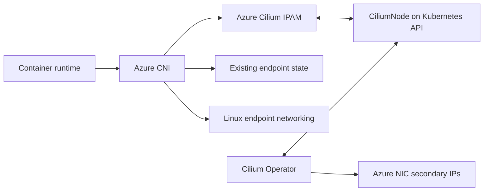
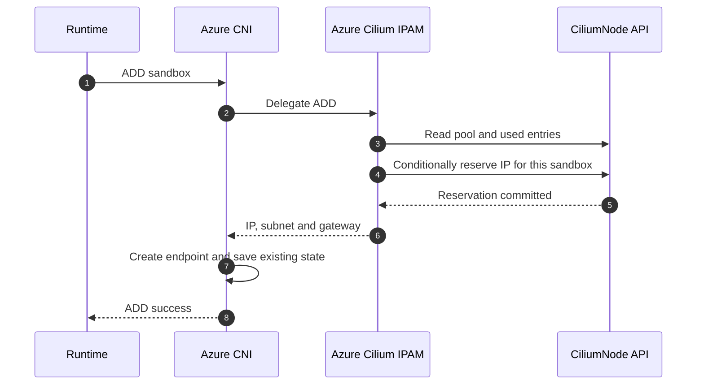
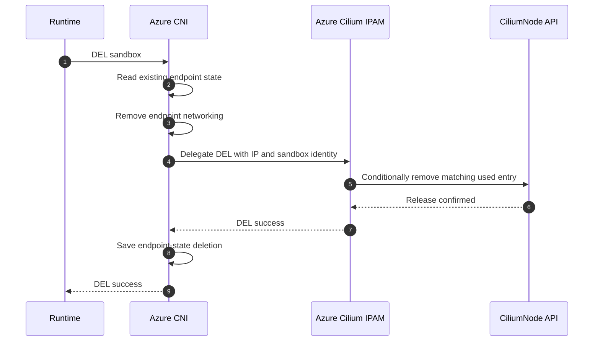
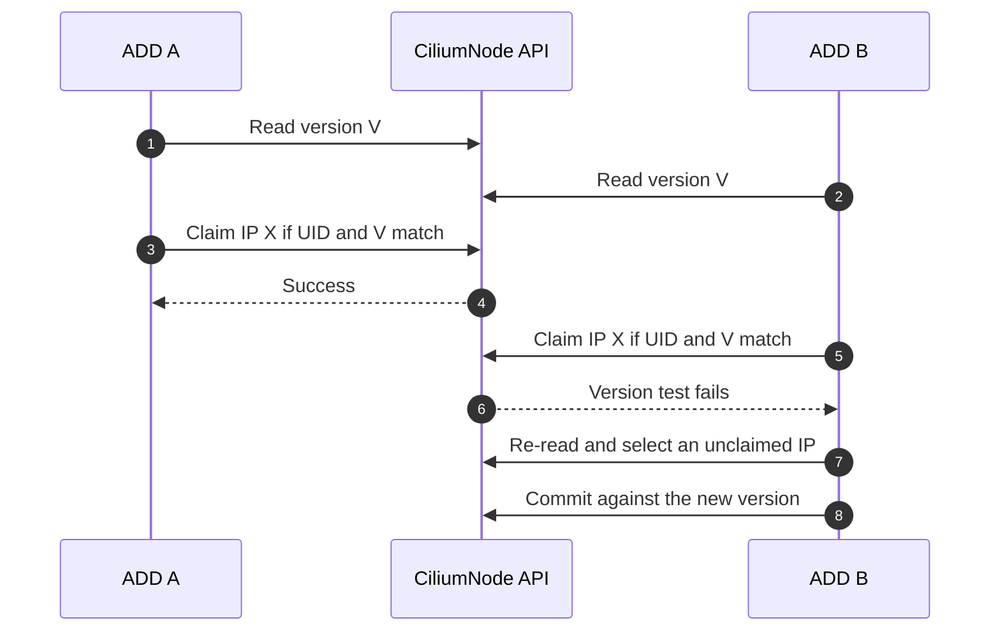
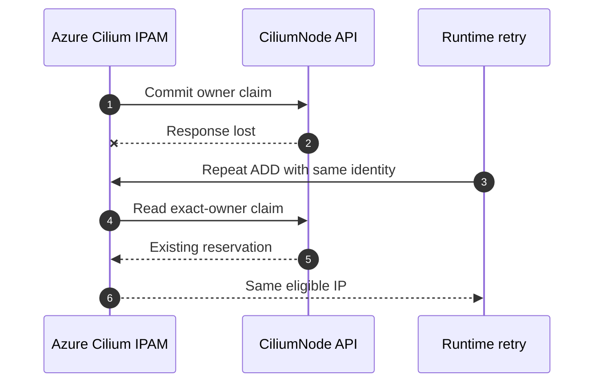
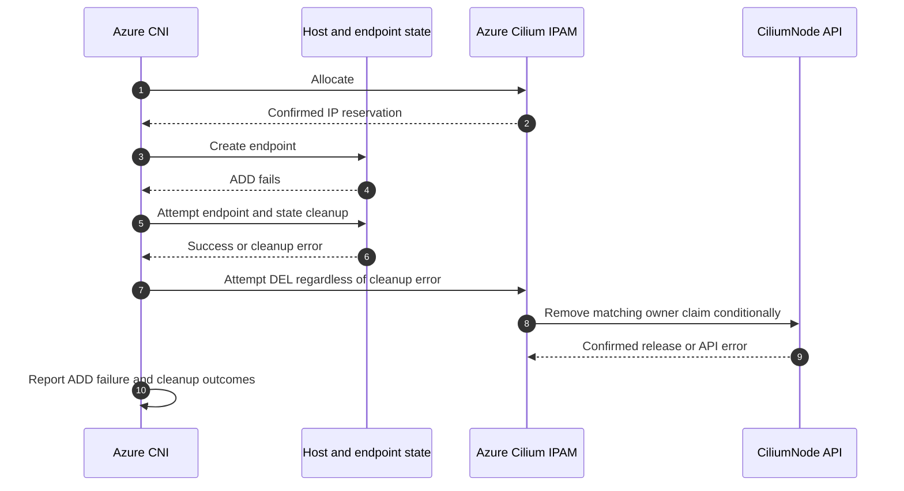
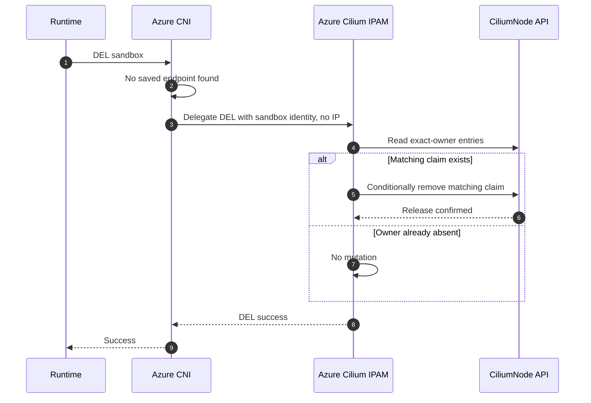
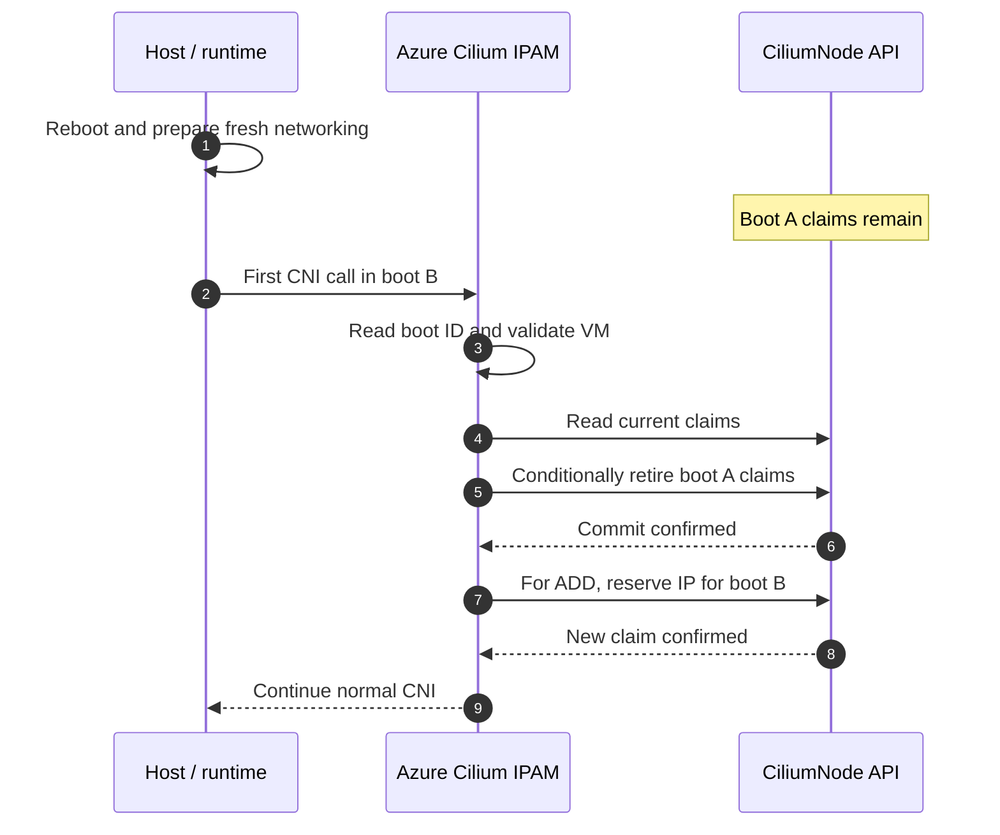
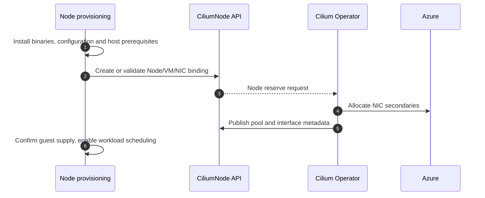

# Azure CNI with Cilium Operator IPAM

## 1. Design summary

Use **Cilium Operator to allocate Azure NIC secondary IPs** and a separate
**Azure Cilium IPAM plugin to assign those IPs to pods**. Azure CNI
continues to create and delete the pod's networking and keep its existing
endpoint state. The new IPAM plugin reads and updates CiliumNode directly;
it has no local allocation database and does not run as a daemon.

The operator and IPAM plugin communicate through the Kubernetes API, not
through a direct RPC. The operator owns the published address pool. The IPAM
plugin records which addresses are reserved. CNS and the Cilium agent are not
required.

The diagrams use component names. The Azure CNI network-plugin executable
and configuration `type` remain `azure-vnet`; the proposed Azure Cilium IPAM
executable and `ipam.type` are `azure-cilium-ipam`.



**Figure 1. Component responsibilities.** Azure CNI owns endpoint networking;
Azure Cilium IPAM owns pod reservations; Cilium Operator owns cloud allocation.

### ADD happy path

Azure CNI delegates IPAM ADD to Azure Cilium IPAM. The plugin reads the
node's pool, selects an eligible unused IP, and records the reservation on
CiliumNode **before returning the address**. Azure CNI creates the endpoint
and saves its normal endpoint information.



**Figure 2. ADD commits ownership before the address is returned.**

### DEL happy path

Azure CNI restores the endpoint's IP and networking information, removes
the endpoint networking, and delegates IPAM DEL with the known address.
The plugin removes the matching reservation from CiliumNode. Azure CNI then
saves the endpoint-state deletion and returns success.



**Figure 3. Preserve the existing normal CNI DEL order.** Endpoint networking
is removed before IP release; the saved endpoint record is retired afterward.

**Does DEL make the IP available again? Yes.** The exact update is to
**`CiliumNode.status.ipam.used`**, not to the pool spec. The IP remains in
**`spec.ipam.pool`** while both used and unused. Removing its used entry makes
it available for another allocation, provided it still passes eligibility
checks. Pod DEL does not remove the Azure NIC secondary configuration.

This is the proposed implementation contract. The reboot mechanism in
section 8 is a concrete addition for review; it was not specified in the
meeting. Ordinary reboot and transient release failures must recover without
manual reconciliation or node replacement.

## 2. Scope and component boundary

The initial target is Linux Kubernetes on standalone Azure VMs: one selected
primary NIC, individual secondary IPv4 addresses, and one node/pod subnet.
Azure CNI retains transparent-tunnel networking. VMSS, AKS, Windows, IPv6,
prefix allocation and multiple allocation NICs are outside this change.

| Component | Responsibility |
| --- | --- |
| Azure CNI | Normal CNI lifecycle, endpoint setup/cleanup, and existing endpoint state |
| Azure Cilium IPAM | Read qualified supply; atomically claim or release an IP; reconcile previous-boot claims |
| Cilium Operator | Allocate NIC secondaries, publish pool/interface metadata and replenish reserve |
| Node provisioning | Register the correct Node/VM/NIC binding and install one coherent consumer |

Select the plugin using `ipam.type: azure-cilium-ipam`. Keep the outer
`type: azure-vnet` and `mode: transparent-tunnel`. A host configuration file's
existence must not select the allocator. Missing credentials, an absent
executable or an unsupported combination must return an explicit error, not
fall back to another IPAM implementation.

The network plugin delegates through the existing CNI interface. It does not
parse CiliumNode, read a Cilium-specific state file or initialize a Kubernetes
client. Kubernetes dependencies belong in the new executable. Reuse existing
guest-discovery clients rather than introducing a separate ARM allocator.

Configuration consists of the node identity, API credential input and selected
guest interface. The network plugin validates the supported outer combination
before early dispatch paths can bypass IPAM. The IPAM executable validates its
own configuration and remote identity.

## 3. Pool, reservation and endpoint information

There are two different records, not two copies of the same allocation store:

| Information | Location | Writer |
| --- | --- | --- |
| Addresses allocated to this node | `spec.ipam.pool` | Cilium Operator |
| Azure NIC/subnet/address metadata | `status.azure.interfaces` | Cilium Operator |
| Address reserved for a sandbox | `status.ipam.used` | Azure Cilium IPAM |
| Pod IP, host interface and endpoint teardown details | Existing Azure CNI network state | Azure CNI |

The pool includes reserved addresses. For example:

```json
{
  "spec": {
    "ipam": {
      "pool": {
        "10.20.16.10": { "resource": "<nic-resource-id>" },
        "10.20.16.11": { "resource": "<nic-resource-id>" }
      }
    }
  },
  "status": {
    "ipam": {
      "used": {
        "10.20.16.10": {
          "owner": "<stable-reservation-owner>",
          "resource": "<nic-resource-id>"
        }
      }
    }
  }
}
```

Here `.10` is reserved and `.11` is unreserved. DEL for `.10` removes its
`used` entry; neither pool entry changes.

The owner identifies a **network, sandbox and interface**, not merely a pod
name. It also includes the VM's immutable identity and kernel boot ID for
reboot reconciliation. A proposed versioned encoding is:

```text
azure-cilium-ipam/v1/<vm-unique-id>/<boot-id>/<network>/<sandbox-id>/<ifname>
```

Each component is escaped unambiguously. The runtime must allocate a new
sandbox ID for a new sandbox incarnation, including after reboot; delayed
requests for old sandboxes must not be replayed as requests for new ones.
Normal duplicate requests within one sandbox use the same owner.

CiliumNode is bound to the Kubernetes Node UID through its owner reference,
to the VM ARM ID through `spec.instance-id`, and to the immutable VM ID through
the proposed `azure-container-networking.io/vm-id` annotation. Provisioning
creates this binding; ordinary requests validate rather than replace it.
The selected NIC resource remains on every reservation.

These are API-resident fields, not another host file. The boot ID is read
from `/proc/sys/kernel/random/boot_id`; it is not generated or written by
the plugin. A credential or process restart does not change it.

## 4. ADD and concurrent ownership

For each ADD:

1. Validate the Node/VM/NIC binding and current kernel boot ID.
2. Read the current CiliumNode and reconcile this consumer's previous-boot
   reservations as specified in section 8.
3. If this owner already has one eligible claim, return that IP. Do not
   allocate a second address for a duplicate ADD.
4. Otherwise select an eligible free IP, copy its NIC resource into `used`,
   and conditionally commit the claim.
5. Return the standard IPAM result only after the commit is confirmed.

An eligible address must be in the operator pool, belong to the selected NIC
and subnet, appear as a successful secondary in the compatible metadata, and
be visible through current guest discovery. Never offer the host primary IP.
Host networking must not have claimed pod secondaries as local host addresses.
Temporary publication/programming lag withholds the affected address.

The patch tests the observed CiliumNode UID and resourceVersion. It updates
only the consumer's intended entries and preserves other owners, Azure
interface status and operator diagnostics. If a parent field is absent,
construct it without replacing populated status content.



**Figure 4. The API commit, not selection in memory, determines ownership.**

Conflict retries are bounded by the request deadline and a finite backoff
budget. A changed UID is an identity error, not an ordinary conflict. A
malformed patch or authorization failure is surfaced rather than retried
indefinitely.

If a claim response is lost, the next ADD searches by the same owner. A
confirmed existing eligible claim returns the same address. An existing
claim that has become ineligible is retained for release and returns an
error; it does not cause a second allocation.



**Figure 5. ADD replay resolves uncertain responses without another claim.**

## 5. DEL ordering and retry behavior

Keep the existing normal stateful CNI sequence shown in Figure 3:
**remove endpoint networking, release IPAM ownership, then save endpoint-state
deletion**. Do not move the saved-state deletion ahead of the release.
The release request carries the endpoint address already known to Azure CNI.
Delegated DEL returns success or an error, not an address result.

There are two meanings of "delete the endpoint" in the review discussion.
In the inspected shared node-subnet/CNS caller, `DeleteEndpoint` performs
network cleanup **before** the invoker's IP release, while `DeleteState`
saves the endpoint-record deletion **after** it. This order predates the PR;
see the [normal DEL source][src-del]. The proposal follows that code rather
than claiming all existing modes release before physical cleanup.

The IPAM plugin conditionally removes only the requested owner's reservation.
It does not require the address to remain eligible for new allocation: an
IP withdrawn from the pool still needs to be releasable. Fresh allocation
discovery or an ARM operation is not required for DEL.

| Condition | Required behavior |
| --- | --- |
| Matching address and owner | Remove that used entry with UID/version tests |
| Owner already released | Return idempotent success without changing another owner |
| Address now owned by a different sandbox | Do not remove the new reservation; a duplicate old-owner DEL is a no-op if the old owner has no claim |
| Owner exists at an unexpected address, or duplicate owner records exist | Report an ownership inconsistency rather than guessing |
| API unavailable or credentials rejected | Return an explicit release error; retry later |

When remote release fails during normal DEL, Azure CNI does not proceed to the
final state deletion. A retry can recover the known endpoint information and
repeat cleanup/release. If no endpoint record is available, the plugin can
release by exact sandbox owner as described in section 7. A failed API call
never counts as confirmed release.

If the release succeeds but the final state write fails, report that failure
and preserve idempotent retry behavior. The caller's existing local
serialization remains. The network cleanup implementation must not delete
another active endpoint's shared-IP membership when replaying stale cleanup;
this requires the exact-IP reuse regression in section 10. An IPAM owner
check protects the reservation, not every host-side cleanup operation.

For that retry, use the existing endpoint inventory under the existing CNI
operation lock: if another endpoint record uses the address, preserve its
IP-shared membership and remove only the old endpoint's interface-specific
objects. Do not remove shared node rules. This is a narrow endpoint-cleanup
idempotency requirement, not a new Kubernetes read in the network plugin or
an additional persistent allocation record.

Normal DEL still stops on an endpoint-cleanup error before reaching release,
matching the inspected caller. Failed-ADD rollback is different: its separate
allocation cleanup still runs. That distinction is intentional and is
described next.

## 6. Failed ADD: still attempt IP release

Preserve the existing failed-ADD cleanup policy. Once allocation has
succeeded, Azure CNI registers an allocation-cleanup defer. Its endpoint
cleanup runs separately. Even if endpoint or state cleanup reports an error,
the allocation-cleanup defer still attempts IPAM DEL.

This is how the [existing ADD defers][src-add] and
[`cleanupAllocationOnError`][src-add-release] are structured. A return from
the endpoint-cleanup defer does not cancel the other registered defer.
The proposal must not introduce an additional rule that permanently retains
the claim merely because endpoint cleanup failed.



**Figure 6. A networking-cleanup error does not skip the IP-release attempt.**

If the API release succeeds, the reservation is removed. If it fails, the
claim remains until a repeated DEL succeeds, or until automatic previous-boot
reconciliation after an actual reboot. Retaining a claim because the API
could not be updated is different from intentionally refusing to attempt
release because host cleanup failed.

This preserves existing best-effort rollback behavior; it does **not** make
endpoint teardown and IP release an atomic transaction. Residual host rules
are still a networking error to report and clean up. The runtime must abandon
the failed sandbox rather than treat the failed ADD as successful. Tests must
cover cleanup errors, retained cleanup inputs, exact-IP reuse and stale
requests; an empty used entry alone does not prove a clean dataplane.

## 7. DEL without a saved endpoint

The existing caller already delegates DEL with no address when no endpoint
is found, using the sandbox/container identity. The new plugin supports that
same path by finding the exact owner in `status.ipam.used`.

It does not ask Azure CNI to parse CiliumNode and does not return an IP through
the DEL response. It removes only the matching network/sandbox/interface
reservation on the bound VM. An absent owner is idempotent success. A claim
belonging to another sandbox is never released by matching the IP alone.



**Figure 7. Missing endpoint state does not create a manual IPAM repair path.**

This path follows the existing runtime-directed cleanup contract. It is not
a background guess based on a missing file or a pod disappearing from the API.
It releases the explicitly identified sandbox; it does not clear unrelated
claims. Any inability to clean missing host information remains the existing
networking recovery concern, not a reason to require node replacement for an
otherwise valid IPAM DEL.

The [CNS invoker][src-cns] can additionally hand connection failures to its
existing async-delete mechanism. The new plugin does not inherit that worker
or queue. It uses synchronous API release and runtime retry, as agreed for
the first version.

## 8. Automatic reboot reconciliation

**A normal reboot must not require manual reconciliation.** The local
endpoint state and the API object have different lifetimes; the plugin must
account for that explicitly instead of treating their disagreement as an
irreversible error.

On Linux the default endpoint-state path is
[`/var/run/azure-vnet.json`][src-paths], normally on volatile storage.
The source also has [network rehydration behavior][src-network-restore] for
retained state; file reset is not a universal rule for every installation.
The [legacy IPAM restore path][src-ipam-restore] can mark addresses unused
after detecting reboot. For this integration, support the fresh-sandbox
Linux reboot model: old pod networking is not restored, and the runtime
creates new sandbox identities.

### Proposed mechanism: qualify claims by kernel boot ID

Every new reservation's owner includes the immutable VM ID and Linux kernel
boot ID from section 3. On ADD or DEL, the plugin reads the current boot ID
and the bound CiliumNode. Before allocating, it conditionally removes only
recognized reservations for **this same VM and an earlier boot**.

The reason is specific: processes and pod network namespaces from that
kernel boot cannot survive a real reboot. A plugin restart, kubelet restart,
credential refresh, elapsed time or missing JSON file is **not** evidence
of a new boot and must not trigger this cleanup.

No separate reset flag, local boot record, startup database or operator
RPC is needed. The discriminator is stored in each existing remote owner
field. There is no change to the Cilium CRD schema.



**Figure 8. Reconcile old usage automatically on the same VM after reboot.**

The implementation must enforce these conditions:

| Condition | Required behavior |
| --- | --- |
| Same immutable VM, same Node binding, different recognized boot ID | Retire that previous-boot consumer claim automatically |
| Current boot ID | Preserve the claim unless the explicit DEL matches its sandbox |
| Two first requests after reboot race | UID/version tests serialize cleanup; the loser re-reads and preserves any newly created current-boot claim |
| Reset response lost or process exits during reset | Re-read and repeat; removal of old-boot entries is idempotent |
| API unavailable during reboot | Return a retryable error; do not allocate offline. Retry automatically when the API recovers |
| Missing/unreadable boot ID, unknown owner format or foreign VM identity | Do not guess or clear the entry; report an incompatible binding/ownership error |

Reconciliation can be a separate conditional status patch followed by the
normal claim patch. The second patch uses a fresh snapshot after any conflict.
An interrupted reset therefore leaves either old claims still reserved or
old claims already removed; it cannot erase a newly committed current-boot
claim. Preserve the operator's pool, interface metadata and diagnostics.

For a delayed DEL from an old sandbox, match the exact sandbox tuple rather
than a pod name or a desired IP. Previous-boot entries may already have been
retired; that is success for the old owner, not permission to remove a new
boot's different sandbox claim. The runtime must not reuse sandbox IDs across
incarnations.

### Host and identity prerequisites

The installation must complete normal boot-time host preparation before
enabling this CNI path: no restoration of old pod namespaces, checkpointed
sandboxes or old per-pod tunnel rules; no restoration of stale endpoint files;
and no assigning pod secondaries to the host interface. Shared node networking
is recreated idempotently as endpoints are added. This qualification is part
of reboot testing, not an assumption that remote cleanup fixes host routes.

VM replacement, snapshot/hibernation restore and CiliumNode deletion are not
ordinary reboot. A changed immutable VM ID or Node binding must not be
treated as permission to clear another incarnation's claims. Provisioning
handles those lifecycle changes explicitly. The automatic path above covers
normal kernel reboot of the same bound VM without requiring an operator to
edit `used` or replace the node.

## 9. Pool growth and minimal installation

Cilium Operator replenishes the pool from actual usage and the configured
`min-allocate` / `pre-allocate` policy. With a pool of ten and a warm reserve
of eight, three reservations leave seven unused addresses and create a
reserve deficit. The operator decides the allocation batch and observes
Azure capacity limits; the plugin does not implement a competing sizing loop.

If no eligible free IP exists, ADD returns a clear capacity or supply-not-ready
error. After the operator publishes usable supply, a normal retry can succeed.
Do not delete state or fall back to another allocator to repair exhaustion.

The reference wire contract is Azure-capable Cilium v1.20.1. Pin and qualify
the matching image, chart and CRD together. The
[pinned Azure backend][src-azure-backend] does not implement automatic
NIC-IP reclamation, so pod DEL returns an address to the node's reusable pool,
not the Azure subnet.

For a new node:

1. Install a matching `azure-vnet` / `azure-cilium-ipam` pair and the generated
   transparent-tunnel configuration with the single explicit IPAM selector.
2. Provide node-scoped API access. The plugin needs reads and status updates
   on its own CiliumNode, not ARM allocation permissions.
3. Register or validate the Node UID, immutable VM annotation, ARM instance
   ID, selected Azure NIC name and reserve settings. Existing usage must
   not be overwritten by provisioning.
4. Start the operator without its agent/CNI and wait for qualified supply.
   The API/operator bootstrap path must not depend on first obtaining an
   ordinary pod IP from that same pool.



**Figure 9. Initial registration is distinct from ordinary pod allocation.**

Binary extraction through the release image is sufficient for the initial
self-managed deployment. A dedicated installer, credential automation,
broader availability work and policy coordination remain separate delivery
work; they are not expanded here into the IPAM lifecycle design.

## 10. Required tests

These tests establish the behavior described above, rather than merely
checking that an object or file exists.

| Area | Acceptance case |
| --- | --- |
| ADD | Claim commits before returning the IP; concurrent requests cannot reserve the same address |
| Replay | Duplicate ADD returns the same eligible claim; lost responses do not consume a second IP |
| Status ownership | Claim/release/reset preserve other owners and all operator-owned fields; use an actual API server for status/patch semantics |
| Normal DEL | Observe networking cleanup, IP release, then saved-state deletion; a release error does not advance to the final state deletion |
| Failed ADD | Inject endpoint cleanup and state cleanup failures; verify IPAM DEL is still attempted and both failures are observable |
| API failure during cleanup | Failed release leaves a remote claim; subsequent explicit DEL removes it after API recovery without manual repair |
| No endpoint record | DEL finds the exact sandbox owner remotely; a missing owner succeeds without touching a different sandbox |
| Stale cleanup after reuse | Release succeeds, final state write fails, another sandbox reuses the IP, then the old DEL retries; the new reservation and active endpoint rules must survive |
| Reboot | Reboot with active pods and retained remote usage; old-boot claims disappear automatically and new pods get usable networking without editing the CR |
| Reboot race/interruption | Concurrent first CNI calls, process exit after reset and a lost reset response never delete current-boot claims |
| Not a reboot | Restart IPAM/kubelet or remove a local state file during the same boot; unrelated current-boot reservations remain intact |
| Boot-time API outage | New allocation pauses; after API recovery, reboot reconciliation and ADD recover automatically |
| Host reboot behavior | No old pod rules/endpoints are restored; host primary connectivity, pod traffic and transparent-tunnel rules recover |
| Identity | VM replacement, foreign NIC, wrong Node UID, unknown owner format or missing boot ID cannot trigger a guessed global reset |
| Configuration | Explicit mode with missing inputs or unsupported dispatch fails; non-opted-in CNI behavior is unchanged |

Endpoint cleanup can fail independently of release. The stale-cleanup test
must exercise both reservation ownership and Linux rules; a matching owner
check in IPAM alone cannot prove that a stale network cleanup is harmless.
Use existing endpoint identity and cleanup helpers, and make any necessary
retry fix narrowly scoped to the behavior under test rather than moving
Kubernetes ownership logic into Azure CNI.

Normal reboot recovery must be demonstrated on the supported Linux image,
not inferred from a changed boot ID in a unit test. The complete integration
test must include guest programming, runtime sandbox recreation and same-node/
cross-node traffic.

## 11. Answers to the review questions

**Does DEL move the IP from used to available?** Yes: remove the matching
`status.ipam.used` entry. The IP stays in `spec.ipam.pool` and on the NIC.

**What happens when local state resets on reboot but CiliumNode persists?**
The proposed owner boot ID lets the new plugin automatically retire this VM's
previous-boot reservations before allocating. No manual reconciliation is
part of the ordinary reboot path. Same-boot restarts do not reset usage.

**Should release happen before deleting the endpoint?** Preserve the actual
existing distinction: normal `DeleteEndpoint` networking cleanup comes first,
IPAM release next, and saved-state deletion last. The earlier proposal's
saved-state-before-release ordering is not used.

**Should failed ADD still release an IP if endpoint cleanup fails?** Yes.
Keep the independent allocation-cleanup attempt. A failed API update can
leave a reservation pending retry, but a host-cleanup error does not itself
skip IP release or require node replacement.

**Why keep Azure CNI state?** It provides the endpoint teardown inputs and the
known address for normal DEL. The IPAM plugin does not need another local copy.

**What needs design agreement beyond the meeting?** The versioned owner
encoding and automatic previous-boot reconciliation in section 8. They solve
the remote/local lifetime mismatch without adding a host allocation store.
Implementation must also pass the stale-cleanup reuse test; this document
does not claim that existing best-effort cleanup makes networking and IPAM
an atomic transaction.

## 12. Source references

The lifecycle comparison uses the pre-PR base
`6bc9a78e3bc551028e55bdd99245401da18ad461`, so it describes existing behavior
rather than behavior introduced by this integration.

| Source | Relevant behavior |
| --- | --- |
| [Normal DEL][src-del] | No-endpoint identity release; endpoint networking cleanup; IPAM release; final state save |
| [Failed-ADD defers][src-add] and [allocation cleanup][src-add-release] | Allocation cleanup is separate and still attempts release after endpoint-cleanup errors |
| [Azure IPAM invoker][src-invoker] | Delegates a known address, or delegates DEL without an address |
| [CNS invoker][src-cns] | Uses sandbox identity and supports its own async connection-failure handoff |
| [Linux state paths][src-paths] and [network restore][src-network-restore] | Default `/var/run` paths; rehydration logic when state remains |
| [Legacy IPAM restore][src-ipam-restore] | Can mark IPs unused after reboot detection |
| [Cilium allocation types][src-types] | Pool includes used addresses; owner/resource fields and status semantics |
| [Azure operator backend][src-azure-backend] | Cloud allocation and currently unsupported NIC-IP release |

[src-del]: https://github.com/Azure/azure-container-networking/blob/6bc9a78e3bc551028e55bdd99245401da18ad461/cni/network/network.go#L1173-L1251
[src-add]: https://github.com/Azure/azure-container-networking/blob/6bc9a78e3bc551028e55bdd99245401da18ad461/cni/network/network.go#L591-L679
[src-add-release]: https://github.com/Azure/azure-container-networking/blob/6bc9a78e3bc551028e55bdd99245401da18ad461/cni/network/network.go#L905-L921
[src-invoker]: https://github.com/Azure/azure-container-networking/blob/6bc9a78e3bc551028e55bdd99245401da18ad461/cni/network/invoker_azure.go
[src-cns]: https://github.com/Azure/azure-container-networking/blob/6bc9a78e3bc551028e55bdd99245401da18ad461/cni/network/invoker_cns.go#L353-L439
[src-paths]: https://github.com/Azure/azure-container-networking/blob/6bc9a78e3bc551028e55bdd99245401da18ad461/platform/os_linux.go#L22-L30
[src-network-restore]: https://github.com/Azure/azure-container-networking/blob/6bc9a78e3bc551028e55bdd99245401da18ad461/network/manager.go#L189-L281
[src-ipam-restore]: https://github.com/Azure/azure-container-networking/blob/6bc9a78e3bc551028e55bdd99245401da18ad461/ipam/manager.go#L132-L156
[src-types]: https://github.com/cilium/cilium/blob/7d68cfb394f2960e10aa72e76d0d51e66c1b2ebc/pkg/ipam/types/types.go
[src-azure-backend]: https://github.com/cilium/cilium/blob/7d68cfb394f2960e10aa72e76d0d51e66c1b2ebc/pkg/azure/ipam/node.go
